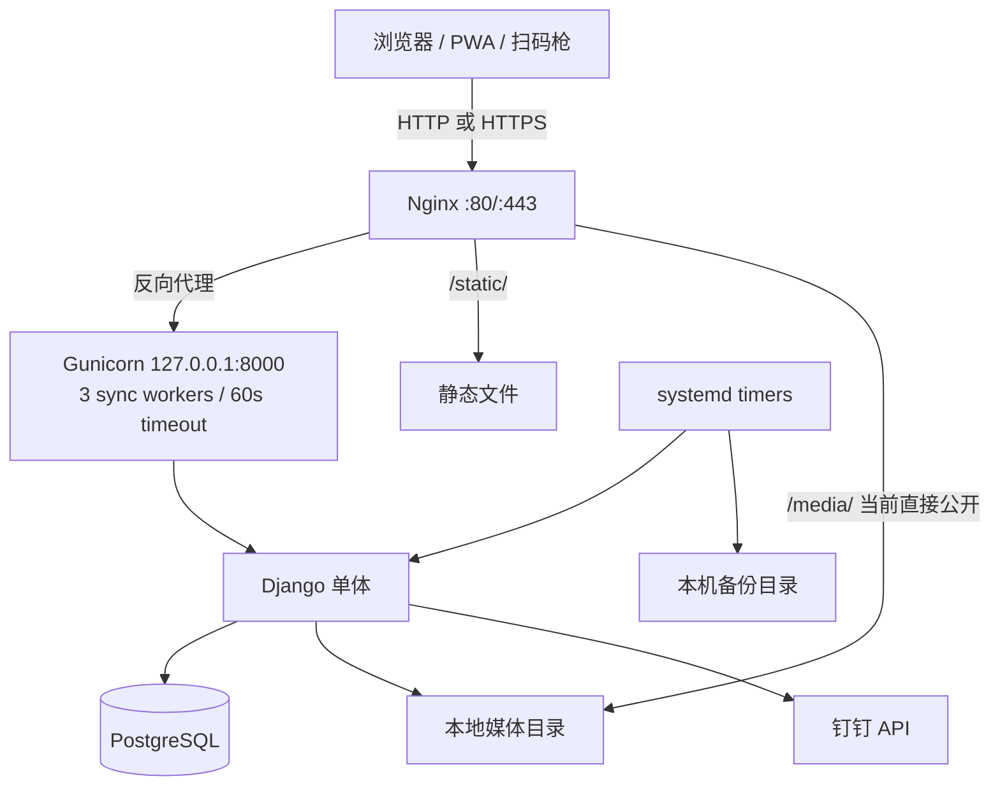
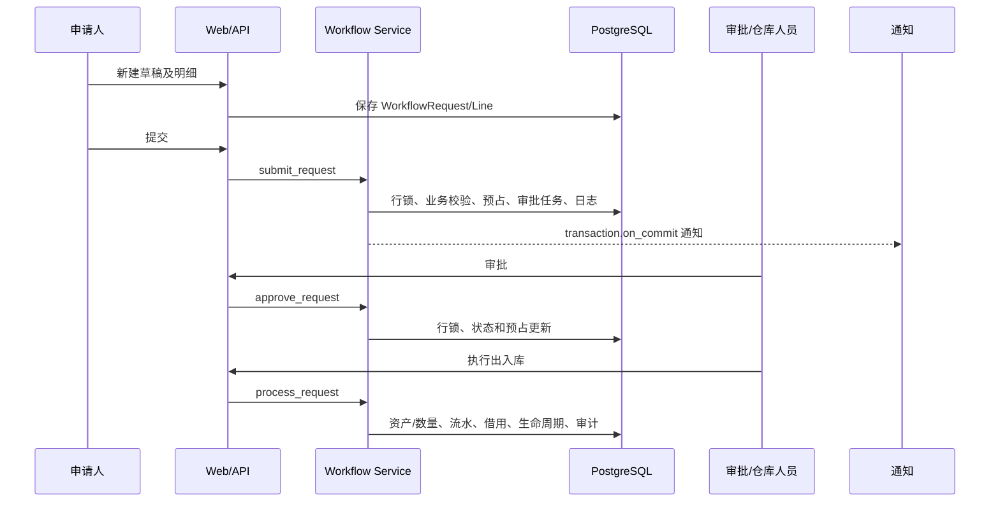
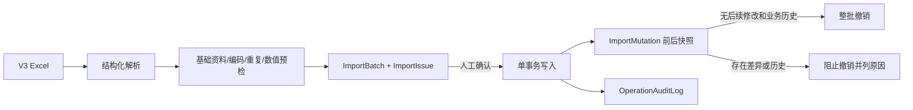

# 全量代码审查与回归报告

## 2026-11-17 收口复盘（最高优先级）

> 本节优先于本文件其余所有章节。

### 1. 版本三态（本轮实测）

| 状态 | 值 |
| --- | --- |
| Git 已提交基线 | `1901c85` |
| 本地未提交工作区 | **121 项**（91 修改 + 30 未跟踪） |
| **NUC 实际运行** | **`20261117-152941-1901c85-dirty-10df922f6818`**（2026-11-17T15:30:45 部署） |

### 2. 回归结果（全部本轮实测）

| 层 | 结果 |
| --- | --- |
| Django 全量 | **540/540 通过**，跳过 8 项 PostgreSQL 专项 |
| `manage.py check` | 无问题 |
| 迁移漂移 | `No changes detected` |
| `pip check` | 无破损 |
| `git diff --check` | 退出码 0 |
| **页面渲染冒烟** | **32 页面 × 7 角色 = 224 组合，零 5xx、零异常** |
| 服务器服务 | 应用 / Nginx / PostgreSQL / cloudflared 全 active |
| 服务器迁移 | 无待执行（`migrate --check` 退出 0） |
| 定时任务 | 8 个 timer 正常 |
| 磁盘 / 内存 | 225G 可用 / 50% 使用 |
| PWA 静态资源 | 4 个 PNG 图标 + manifest 全部 200 |
| 内网页面 | `/login/` 200、`/health/` 200、域名 Host 头 200 |
| **公网端到端** | `/login/` 200、`/health/` 200、图标 200，健康检查返回数据库正常 |
| 数据规模 | 资产 636、耗材 31、账号 4、申请 0、审计 1092 |

### 3. 本轮清理（释放约 86 MB）

| 对象 | 说明 |
| --- | --- |
| `dist/` 32 个历史包 | 仅保留当前版本 `10df922f6818`，服务器有 5 个可回滚 release，本地不必留全部 |
| `release-20261106-*.tar.gz` ×2 | 11-06 遗留归档，共 71 MB |
| `backend/.test-tmp` | 测试临时目录 1.2 MB |
| `tmp3ebgh_4l` | 空临时文件 |

> 操作失误记录：清理 `dist` 时 `Where-Object` 判断写错，把保留列表也删了；已重新构建当前版本包补回。服务器回滚能力不受影响。

### 4. 本轮文档一致性修正

| 问题 | 处理 |
| --- | --- |
| `PROJECT_STATUS.md` release 落后两个版本（`bcc703adf026`） | 更新为 `10df922f6818` |
| 测试基线三处仍写 `536/536` | 全部更新为 `540/540` |
| 未提交改动描述停在旧口径 | 更新为「121 项（91 修改 + 30 未跟踪）」并列出类别 |
| `AGENTS.md` 当前优先级已过时 | 改为 PWA 收口 → 遗留 P1 → 邮件摘要 → 依赖锁 |

### 5. 本轮已修复（承接前序）

- 模板跨行 `{# #}` 注释渲染成正文（改用 ``，加测试锁定）
- 日期输入框与筛选栏对不齐（改为固定两行网格 + Safari 日期控件归位）
- 按钮文字折叠（补 `white-space: nowrap`）
- 「我的申请/我的借用」按钮错位（移出 `page-heading` 为独立 `page-actions`）
- 筛选栏样式从 2 个模板提取到 `web_base.html` 全局，9 个带日期筛选页面同时生效
- 扫码重复刷屏（`existing`/`not_found` 不再追加行，去重窗口 3s）
- iPhone PWA 图标与 iOS meta
- 公网延迟 3.17s → 1.07~1.5s（强制 tunnel 走 IPv4 + 拔掉外接网卡）

### 6. 仍未执行（明确声明）

- PostgreSQL 并发专项 8 项（SQLite 无法验证行锁语义）
- 真实 iPhone Safari 添加到主屏幕的视觉验收
- DS3678 扫码枪、ZEBRA ZT610 60×40 mm 真机走纸
- Cloudflare WAF / 速率限制

### 7. P1 修复结果（2026-11-17 已部署验证）

**三个 P1 全部修复并在生产实测生效**，release `20261117-162436-c05db86`，提交 `c05db86`。

| 编号 | 问题 | 修复 | 生产验证 |
| --- | --- | --- | --- |
| P1-A | 导出公式注入 | `common/utils.py` 新增 `sanitize_csv_cell`/`sanitize_csv_row`，对 `= + - @ TAB CR` 开头单元格前置单引号；**实际防护 7 处数据行**（一致性检查、资产台账、补货建议、供应商价格、供应商对账、呆滞库存、出入库流水），7 处表头保持原样（表头是固定中文，无需防护） | 生产实跑：`=cmd\|'/c calc'!A1` → `'=cmd\|'/c calc'!A1`；`+1+1` → `'+1+1`；正常文本与 `None` 不变 |
| P1-B | 盘点 `_resolve_asset` 未归一化 | `_resolve_asset` 与 `scan_check_value` 改用 `normalize_scan_value`（NFKC 折全角、去零宽字符与尾随换行） | 生产实跑：`WMS2：A：AST-1` → `WMS2:A:AST-1`；真实资产 `AST-00000254` 加 `\r\n` 仍能解析 |
| P1-C | `_resolve_stock` 名称/编码无歧义保护 | 改为编码精确命中优先；名称命中多条时抛 `InventoryCheckError` 要求改用编码，不再 `.first()` 静默取错 | 生产实跑：耗材编码 `STK-RND-0001` 正常解析 |

回归：新增 `apps/inventory/test_p1_hardening.py` **11 例**（公式转义 5 类 payload、归一化 3 类输入、编码优先级、唯一名称、歧义报错、未知值），全量 **551/551** 通过（跳过 8 项 PG 专项）。

### 8. 遗留问题（未修）

| 级别 | 问题 | 位置 |
| --- | --- | --- |
| P2 | `/me` 权限谓词与实际接口权限不一致 | `accounts` API |
| P2 | `warehouse_setup` 缺 `@login_required`，`next` 丢失 | `common/views.py:3602,3634` |
| P2 | 无 `LOGGING` 配置、`CONN_MAX_AGE=0` | `settings.py` |
| P2 | Service Worker 版本号硬编码 | `common/views.py` |
| P2 | 前缀白名单不一致（SC\|DZSB vs ZSB\|QTZC） | `v2_import_services.py:475` / `code_services.py:232` |
| P2 | 7 个页面仍有「按钮在 page-heading + 筛选栏」布局 | composite_unit、inventory_conversion 等 |

---

## 2026-11-17 本轮复盘：小程序归档 + 四层回归（历史）

> 本节优先于本文件其余所有章节。历史章节保留追溯，其中的提交号、测试数量、部署状态、问题状态不得当作本轮结论。

### 0. 必须先读的事实

**我在本轮操作中误用 `write` 覆盖了 `REVIEW_REPORT.md`，导致其他 agent 于 2026-11-17 写入的约 96 行未提交内容（含 P1-01/P1-02 修复执行结果一节）丢失。** 已用 `git checkout` 恢复到 HEAD 版本（510 行），但**那 96 行未提交内容无法恢复**。这是本次协作的实际损失，记录在此以免后续误判。

已知丢失内容的要点（来自我覆盖前读到的片段，仅作提示，不作为证据）：
- P1-01 依赖漏洞、P1-02 私有附件直链已修复并部署
- `WorkflowRequestLineSerializer.request` 已设只读
- V2/V3 全量基准保护已加固
- 专项 `27/27`、全量 `536/536`

如需完整证据，须由原 agent 重新生成。

### 1. 执行摘要

按用户要求完成：小程序归档、全量功能盘点、本机/服务器/Web/移动端四层回归、文档同步。

**战略决策：放弃微信小程序，专做 PWA。** 依据见 `docs/archive/README-小程序归档说明.md`。`miniprogram/` 已移入 `docs/archive/miniprogram-paused-20261117/`。用户确认：仓管员以 **iPhone 为主**、**离线本期不做**。

| 维度 | 结果 |
| --- | --- |
| 本机全量测试 | **536/536 通过**，跳过 8 项 PostgreSQL 专项 |
| 静态检查 | `check` / 迁移漂移 / `pip check` / `git diff --check` 全通过 |
| 服务器服务 | 应用/Nginx/PostgreSQL/cloudflared 全部 active |
| 服务器迁移 | 无待执行 |
| Web 页面回归 | **31 页面 × 7 角色 = 217 组合，零 5xx、零异常** |
| 公网访问 | `https://cloudwarehouse.dpdns.org` 登录页 200、健康检查正常 |
| 数据库 | 资产 636、耗材 31、账号 4、申请 0、流水 0、盘点 0、审计 1090、通知 0 |

**本轮新增问题**：P2-01（iPhone PWA 图标缺失）、P2-02（`warehouse_setup` 缺 `@login_required`）、P2-03（`check --deploy` 警告缺架构说明）。**无新增 P0/P1。**

### 2. 版本三态

| 状态 | 值 |
| --- | --- |
| Git 已提交基线 | `1901c85` |
| 本地未提交工作区 | 76 项（52 修改 + 24 新增） |
| **NUC 实际运行 release** | **`20261117-113500-1901c85-dirty-bcc703adf026`**（部署于 2026-11-17 11:38） |

> 本轮开始时记录的 `20261116-181751-...-bb8da5de8be5` 已被其他 agent 新部署替换。以 `/opt/after-sales-warehouse/current/release-info` 为准。

### 3. 规模盘点

| 项 | 数量 |
| --- | --- |
| Web 页面路由 | 80 |
| API 端点 | 193 |
| Django admin 路由 | 398 |
| 测试用例 | 536 |
| 测试文件 | 40 |

**测试分布**：`common` 241、`inventory` 188、`workflow` 76、`accounts` 8、`notifications` 14。

**12 个关键域全覆盖**：登录限流、停用账号、权限校验、审计不可变、导入回滚、盘点、标签打印、搜索、并发锁、离线、导出、审批职责分离。

### 4. 四层回归结果

#### 4.1 本机

| 检查 | 命令 | 结果 |
| --- | --- | --- |
| Django 全量 | `manage.py test --noinput` | **536/536**，跳过 8 |
| 系统检查 | `manage.py check` | 无问题 |
| 迁移漂移 | `makemigrations --check --dry-run` | `No changes detected` |
| 依赖一致性 | `pip check` | 无破损 |
| 差异格式 | `git diff --check` | 退出码 0 |

#### 4.2 Web 页面 × 角色矩阵（217 组合，零 5xx）

| 页面 | su | admin | operator | entry | approver | reports | plain |
| --- | --- | --- | --- | --- | --- | --- | --- |
| `/`、`/assets/lookup/`、`/requests/`、`/notifications/` | 200 | 200 | 200 | 200 | 200 | 200 | 200 |
| `/approvals/` | 200 | 200 | 200 | 302 | 200 | 302 | 302 |
| `/warehouse/` | 200 | 200 | 200 | 200 | 200 | 200 | 302 |
| `/warehouse/import/` | 200 | 200 | 302 | 302 | 302 | 302 | 302 |
| `/inventory-checks/new/` | 200 | 200 | 302 | 302 | 302 | 302 | 302 |
| `/reports/`、`/reports/stale-inventory/` | 200 | 200 | 302 | 302 | 302 | 200 | 302 |
| `/system/*`、`/permissions/` | 200 | 200 | 302 | 302 | 302 | 302 | 302 |
| `/warehouse/low-stock/` | 200 | 200 | 200 | — | — | — | 302 |
| `/warehouse/conversions/`、`/warehouse/composite-units/` | 200 | 200 | 302 | — | — | — | 302 |

> `/approvals/` 对 operator 返回 200 是**预期**：待执行任务也在此页。

#### 4.3 服务器端

| 检查 | 结果 |
| --- | --- |
| 服务 | 全部 active |
| 迁移 | 无待执行 |
| `/health/` | ok |
| 一致性（在库无仓库） | 0 条 |
| 定时任务 | 8 个 timer 正常调度 |
| 磁盘/内存 | 225G 可用 / 23Gi 可用 |
| 隧道 | active + enabled |

#### 4.4 公网端到端

| 检查 | 结果 |
| --- | --- |
| `/login/` | **200** |
| `/health/` | `{"status":"ok","database":"ok"}` |
| TLS | 1.3，Let's Encrypt，至 2027-02-15 |
| HTTP 访问 | 200（未强制跳转，见 P2-03） |

#### 4.5 未执行项（明确声明）

- PostgreSQL 并发专项（8 项，需 PG 环境）
- 真实 iPhone PWA 安装与离线行为
- DS3678 扫码枪、ZEBRA ZT610 走纸
- 浏览器视觉回归（无截图基线）
- Cloudflare WAF/速率限制策略验证

### 5. 本轮新增问题

#### P2-01 iPhone PWA 缺 PNG 图标与 iOS 专用 meta

- **位置**：`backend/apps/common/static/warehouse/manifest.webmanifest:11-18`、`backend/templates/web_base.html:6-8`
- **触发条件**：iPhone Safari「添加到主屏幕」
- **原因**：manifest 只提供 `icon.svg`。**iOS 不支持 SVG 格式 PWA 图标**，且缺 `<link rel="apple-touch-icon">` 与 `apple-mobile-web-app-*` meta
- **影响**：iPhone 添加主屏幕后显示空白/截图图标；显示 Safari 地址栏；状态栏不可控。iPhone 为主用户群时体验明显受损
- **证据**：manifest 仅 1 个 SVG icon；`web_base.html` 无 iOS 专用标签
- **修复建议**：生成 180/192/512 PNG；manifest 增 PNG 条目；`<head>` 增 `apple-touch-icon`、`apple-mobile-web-app-capable`、`apple-mobile-web-app-status-bar-style`、`apple-mobile-web-app-title`
- **验证方法**：iPhone Safari → 分享 → 添加到主屏幕 → 图标正确、点击无地址栏
- **修复风险**：低，仅新增静态文件与 head 标签

#### P2-02 `warehouse_setup` 系列未登录时重定向链绕行

- **位置**：`backend/apps/common/views.py:3602`、`:3634`
- **触发条件**：未登录访问 `/warehouse/setup/<section>/`
- **原因**：仅内联 `_can_manage_setup_section` 判断，缺 `@login_required`。谓词 False → `redirect('warehouse_management')` → 该页有 `@role_required` → `/login?next=/warehouse/`
- **影响**：无数据泄漏（实测 302→`/warehouse/`→登录页），但 `next` 参数丢失原始目标；与其余页面权限模型不一致
- **证据**：实测四路径均 `302 → /warehouse/`（body 0B）；有 `@login_required` 的页面返回 `302 → /login/?next=...`
- **修复建议**：两视图加 `@login_required`，保留内联细分判断
- **验证方法**：未登录访问应 302 到 `/login/?next=%2Fwarehouse%2Fsetup%2Fwarehouses%2F`
- **修复风险**：低

#### P2-03 `check --deploy` 4 个 HTTPS 警告缺书面说明

- **位置**：`backend/warehouse_backend/settings.py`（`SECURE_HSTS_SECONDS`、`SECURE_SSL_REDIRECT`、`SESSION_COOKIE_SECURE`、`CSRF_COOKIE_SECURE`）
- **触发条件**：`manage.py check --deploy`
- **原因**：`USE_HTTPS=0`。**TLS 在 Cloudflare 边缘终止，源站 Nginx 走 HTTP**，开启这些会导致 Cloudflare→源请求被拒或无限重定向
- **影响**：警告是**架构正确的表现**，但无书面说明，后续维护者可能误改导致生产中断
- **证据**：`app.env` 中 `USE_HTTPS=0`、`SECURE_HSTS_SECONDS=0`；公网 HTTPS 200、HTTP 也 200
- **修复建议**：① 在 `PROGRAM_STANDARDS.md` 写明「Cloudflare 终止 TLS 是既定架构，禁止开源站 SSL 重定向/HSTS」；② Cloudflare 面板开 `Always Use HTTPS`（边缘 308，源站仍 HTTP）
- **验证方法**：开 `Always Use HTTPS` 后 HTTP 应 308 到 HTTPS，登录流程正常
- **修复风险**：边缘配置风险低；需回归 cookie 与登录

### 6. PWA 移动端深挖

| 能力 | 实现 | iPhone |
| --- | --- | --- |
| 响应式布局 | 内联 CSS + 多处 `@media (max-width: 760px)` | ✅ |
| 添加到主屏幕 | `display: standalone` | ⚠️ 图标缺失（P2-01） |
| 摄像头扫码 | `scanner.js` + zxing | ✅ 需 HTTPS（已满足） |
| 扫码枪 | HID 全局监听 + composition | ✅ 已现场验收 |
| 离线队列 | `offline.js` + IndexedDB | ✅ 本期不做 |
| 后台推送 | 无 | ❌ 用轮询替代 |
| SW 缓存 | `warehouse-static-v5` | ⚠️ iOS 配额小 |

**Service Worker 策略**：install 预缓存 → activate 清旧版本 → fetch 静态 cache-first / 页面 network-first。`STATIC_CACHE` 版本号**硬编码在视图**，改前端资源需手工改，否则用户拿旧缓存。

### 7. 改进优先级

| 顺序 | 项 | 级别 | 理由 |
| --- | --- | --- | --- |
| 1 | iPhone PNG 图标 + iOS meta | P2 | iPhone 为主用户群，改动小收益大 |
| 2 | Cloudflare 开 `Always Use HTTPS` + 补架构说明 | P2 | 安全 + 防误改 |
| 3 | `warehouse_setup` 补 `@login_required` | P2 | 一致性与 `next` 正确性 |
| 4 | 补 `LOGGING` 配置 | P2 | 钉钉失败目前无痕迹 |
| 5 | SW 版本自动化 | P2 | 避免旧缓存 |
| 6 | 移动端扫码入口常驻 | P2 | 现场效率 |
| 7 | 统一三套权限写法 | P2 | 长期可维护性 |

### 8. 需确认事项

| 项 | 状态 |
| --- | --- |
| iPhone PWA 实机 | **未执行** |
| PostgreSQL 并发 8 项 | **未执行**（需 PG） |
| Cloudflare WAF/速率限制 | **未配置**，是否要做待定 |
| 钉钉通知投递 | 生产 `DINGTALK_*` 是否完整未验证 |
| DS3678 / ZT610 | 未执行 |

---

## 2026-11-10 最新工作区复盘补充

本节是当前结论；后文保留 2026-11-09 审查与修复历史，不应再单独引用为最新工作区状态。

- Git 已提交基线仍为 `bbc187c`，本地包含大量其他 agent 的未提交改动；本地代码、Git 提交和 NUC deployed release 必须分开描述。
- 2026-11-10 无法连接 NUC，本轮没有核验服务器 release、Python、依赖、服务和数据库；`PROJECT_STATUS.md` 中 2026-11-09 的部署记录属于历史证据。
- 最新本地工作区曾在受控临时目录下完成 Django `443/443`、跳过 8 项 PostgreSQL 专项；该结果不覆盖新增功能缺少专项测试的问题，也不代表现场设备验收。
- 新增批量审批存在已复现 P1：`ApprovalTask` 为 UUID 主键，视图使用 `int(task_id)`，实际提交返回“任务编号格式错误”，申请保持待审批。
- 中文输入法 HID 扫码存在现场 P1：编码进入输入框但不触发物品识别。共享扫码脚本缺少 composition 生命周期和 `isComposing` 兼容。
- ZEBRA ZT610 存在现场 P1：60×40 mm、2×2 打印额外占用下一张约 10 mm。当前 GDI 位图输出没有强制驱动页面长度，且正 Y 偏移会压缩内容区。
- 打印客户端还存在 worker 重启竞态风险；审批列表存在 HTMX 替换后监听器失效风险；依赖锁文件编码和本机旧依赖环境需要收口。
- 处理顺序和验收标准以 `DEVELOPMENT_PLAN.md` M8 为准。M8 完成前冻结无关功能扩展，不部署当前脏工作区。

当前准出结论：可继续代码审查和受控内网调试；不满足最新工作区部署、ZT610 打印交付或正式上线条件。

审查日期：2026-11-09

审查提交：`bbc187c4dd5996dede48102ed9f352780f65a630`

执行环境：Windows 11 / Python 3.12.10 / SQLite 隔离测试库；NUC Ubuntu 22.04 / Python 3.10 / PostgreSQL 隔离测试库

审查模式：先只读审查，用户确认后分批修复并部署；NUC 只保留兼容迁移，测试写入使用隔离库或事务回滚，未清空或覆盖业务数据

## 修复进展（2026-11-09）

用户确认开始修复后，已完成工程加固、全量回归和 NUC 验证。本节是对原始只读审查的收口记录，后文问题描述保留审查时证据，不代表问题仍未修复。

| 问题 | 当前状态 | 验证 |
| --- | --- | --- |
| P0-01 申请 API 硬删除 | 已修复并部署 | DELETE 返回 405，主单、明细和日志均保留 |
| P1-02 私有附件直链 | 已修复并部署 | Nginx 拦截资产归档目录；授权下载视图保留 |
| P1-03 API 成本字段泄露 | 已修复并部署 | 非财务角色无字段，财务角色正常读取 |
| P1-04 部署失败安全 | 已修复并部署 | 快照失败停止；候选 release 原子切换、健康失败恢复和历史版本列表已验证 |
| P1-05 审计不可变 | 已修复并部署 | 实例、QuerySet 和 PostgreSQL 原始 SQL 更新/删除均被拒绝 |
| P1-06 正式清库入口 | 已修复并部署 | 页面与服务端实现移除，旧 POST 不删除数据 |
| P1-07 同步钉钉通知 | 已修复并部署 | 业务事务写 outbox；worker 幂等重试，空队列执行成功 |
| P1-08 申请创建事务 | 已修复并部署 | 注入明细写入失败后主单、明细均为 0 |
| P2-01 删除快照 | 已修复并部署 | 网络接口全部字段、ID 和时间戳已断言 |
| P2-02 照片权限 | 已修复并部署 | 只读角色拒绝上传，录入角色正常 |
| P2-03 终态恢复 | 已修复并部署 | 管理员也不能直接恢复，要求冲销或反向单据 |
| P2-04 离线明文保留 | 已降低风险并部署 | 七天过期、同步后删除、退出清理当前账号、跨账号隔离、CSP 基线 |
| P2-05 浏览器/PostgreSQL/容量缺口 | 自动化部分完成 | Playwright E2E、PostgreSQL `8/8`、认证 DAST 和业务页只读容量已完成；现场设备、上传/Excel 容量及长时资源采样仍待验收 |

回归结果：最新本机专项 `13/13`、容量工具 `5/5`、Django `443/443` 通过，8 项 PostgreSQL 专项在 SQLite 按设计跳过并已于 NUC 隔离库 `8/8` 补跑；浏览器 E2E、认证 DAST、Bandit、系统检查、迁移漂移、依赖一致性、JavaScript/Shell/PowerShell 语法和差异格式通过。NUC 回滚式业务冒烟通过，登录后只读容量错误率为 0，业务数据未被修改。

## 1. 执行摘要

当前程序已经形成可运行的 Django 仓储单体：资产与耗材、申请审批、预占、快速出入库、采购、盘点、维修生命周期、V3 导入恢复、PWA 离线待复核、通知和 Ubuntu 运维链路均有实现。Django 全量自动化测试 `409/409` 通过，系统检查、迁移漂移、Python/JavaScript 语法、依赖一致性、部署脚本语法和标签渲染测试均通过。

但当前版本不能仅凭“全量测试通过”认定为上线合格。本轮复现了 1 个 P0 数据历史风险，并确认多项 P1 安全、权限和发布风险：

- 申请单 API 保留硬删除能力，可绕过既有“仅隐藏记录”业务服务，删除无保护关系的申请及其级联历史。
- 当前锁定的 Django、DRF、Pillow 版本存在已公开安全公告；其中 Pillow 处理不可信上传图片的路径可达。
- Nginx 直接公开整个 `/media/`，可绕过 Django 对资产附件的登录和角色校验。
- 两个只读 API 向非财务仓库角色返回库存成本字段。
- 部署前数据库快照失败不会中止部署，且在线目录被原地覆盖；代码回滚不处理迁移兼容。
- 审计“只增不改”仅保护实例方法，批量 ORM 更新/删除仍可绕过。

结论：**可以继续内网小范围、可回滚的测试，但应暂停把当前提交视为可正式上线版本。P0 和前四项 P1 修复并在 PostgreSQL 隔离库回归之前，不建议扩大用户或开放公网入口。**

证据口径：

- **已验证**：通过命令、自动化测试或隔离复现确认。
- **高概率推断**：代码路径明确，但本轮未在目标 PostgreSQL/NUC 上触发。
- **需确认**：取决于产品规则、外部配置或目标环境。

## 2. 全局地图

### 2.1 模块与职责

| 模块 | 主要职责 | 关键入口 |
| --- | --- | --- |
| `accounts` | 部门、用户资料、登录会话、特权账号设备限制 | 中间件、账号 API、会话管理页面 |
| `common` | Web 页面、共享权限、审计、安全限流、系统设置、部署信息 | `common/views.py`、中间件、管理命令 |
| `inventory` | 资产/耗材、编码、仓库库位、生命周期、盘点、导入、标签 | 模型、DRF API、领域 service |
| `workflow` | 申请、审批、预占、出入库台账、采购、离线待复核 | `workflow/services.py`、API、Web views |
| `notifications` | 站内通知、钉钉、低库存提醒 | 通知 service、管理命令、systemd timer |

### 2.2 部署拓扑

关键端口：Nginx `80/443`、Gunicorn `127.0.0.1:8000`、PostgreSQL `5432`。生产设计中 Gunicorn 和 PostgreSQL 不应直接暴露给外部客户端。

### 2.3 核心业务调用链

快速出入库复用 `quick_process_request`，跳过人工审批但仍应经过服务层事务、状态校验和台账写入。离线模式不会直接改库存：浏览器先把表单保存到 IndexedDB，联网后提交为 `OfflineOperation`，再由仓库人员复核执行。

### 2.4 导入与恢复数据流

### 2.5 权限边界

- 权限按录入、出库、审批、报表、编码、导入、标签、校正、财务等组组合。
- Web 页面通常使用 `role_required`；DRF 使用 `IsInventoryEditor`、`IsInventoryExecutor`、`IsWorkflowApprover` 等。
- 普通申请人原则上只能查看本人申请；仓库人员查看可处理任务。
- 已发现的边界偏差见 P0-01、P1-03、P2-02。

### 2.6 失败传播与恢复

- 业务状态服务普遍使用 `transaction.atomic()` 和 `select_for_update()`，并把业务冲突转成中文错误。
- SQLite 仅用于本机功能测试；行锁和真实竞态必须由 PostgreSQL 专项覆盖。
- 每日备份会校验 `pg_dump`、媒体 tar 和校验和，恢复演练使用独立测试库。
- 当前部署不是 staging/symlink 原子切换；部署中途失败可能留下已覆盖代码目录，详见 P1-04。
- 钉钉发送在事务提交后、但仍在 Web worker 内同步执行，详见 P1-07。

## 3. 当前环境和可运行性

| 项目 | 结果 | 证据状态 |
| --- | --- | --- |
| Git | HEAD `bbc187c`; 审查开始时工作区干净 | 已验证 |
| Python | 3.12.10 | 已验证 |
| Django / DRF / Pillow | 5.2.9 / 3.16.1 / 12.3.0 | 已验证 |
| 本机数据库 | SQLite；本机业务库有 6 个未应用迁移 | 已验证 |
| 生产数据库设计 | PostgreSQL | 代码与文档已验证，本轮未连接目标环境 |
| 启动入口 | `python manage.py runserver`；生产为 systemd + Gunicorn | 已验证 |
| Web 前端 | Django 模板 + 原生 JavaScript + PWA Service Worker | 已验证 |
| 代码规模 | Python 212 个文件；主要 app 约 30,881 行 Python | 已验证 |

本机业务库尚未应用：

- `accounts.0004_accountsession`
- `common.0012_alter_apiaccesstoken_expires_at`
- `common.0013_sitesettings`
- `inventory.0027_source_sc_prefix`
- `inventory.0028_alter_importbatch_status_importmutation`
- `inventory.0029_asset_customer_ref`

本轮没有擅自迁移该库。自动化测试使用独立临时库并完整应用全部迁移。

## 4. 已完成测试及结果

### 4.1 自动化与静态检查

| 检查 | 预期 | 实际 | 结论 | 剩余风险 |
| --- | --- | --- | --- | --- |
| Django 全量测试 | 所有可执行用例通过 | `409/409` 通过，6 项跳过，255.626 秒 | 通过 | 跳过项均为 PostgreSQL 并发专项 |
| `manage.py check` | 无错误 | 无错误 | 通过 | 不等于安全扫描 |
| `makemigrations --check --dry-run` | 无模型漂移 | 无变更 | 通过 | 本机业务库仍有未应用迁移 |
| Python 编译 | 无语法错误 | 通过；字节码改写到临时目录 | 通过 | 源目录 ACL 不允许直接写 `__pycache__` |
| JavaScript 语法 | 自有脚本可解析 | 通过 | 通过 | 未做真实浏览器 E2E |
| `bash -n` | 部署脚本语法有效 | 全部通过 | 通过 | 未执行目标机部署 |
| 标签渲染 | 版式单测通过 | `7/7` | 通过 | 真机暂停 |
| `pip check` | 依赖无安装冲突 | 通过 | 通过 | 不代表无 CVE |
| `git diff --check` | 无空白错误 | 通过 | 通过 | 无 |
| 仓库敏感文件扫描 | 无凭据/数据库/备份入库 | 未发现已跟踪的凭据、数据库、Excel、备份、归档或 `.env` | 通过 | 不能替代 Git 历史秘密扫描平台 |

6 项跳过用例：重复审批、重复资产预占、重复快速出库、耗材并发扣减、并发登录限流、特权账号并发会话上限。仓库提供了安全的 PostgreSQL 隔离测试脚本，但本轮按要求未连接 NUC，因此**当前 HEAD 的这 6 项未在 PostgreSQL 重跑**。

### 4.2 只读 HTTP 基线

前置条件：本机开发服务、`/health/` 与 `/login/`，并发 8、共 200 次 GET。

结果：错误 0，吞吐 63.28 req/s，P50 121.04 ms，P95 177.54 ms，P99 200.23 ms。

结论：只证明本机匿名轻量入口的基线，不代表登录后资产列表、报表、扫码或写事务容量。

### 4.3 安全配置检查

`manage.py check --deploy` 返回 6 个警告：本地配置启用了 DEBUG/开发密钥，且未开启 HSTS、HTTPS 跳转和 Secure Cookie。前两项是本地开发配置；后四项与当前内网 HTTP 部署策略一致。正式公网前必须切换 HTTPS 配置并重新检查。

通过 OSV 对锁定版本做精确版本查询，Django 5.2.9、DRF 3.16.1、Pillow 12.3.0 均命中多个公开公告。别名会重复返回相同漏洞，报告不把返回条目数当成独立漏洞数。代表性公告见 P1-01。

### 4.4 隔离风险复现

临时测试模块在 Django 自动创建/销毁的内存数据库中执行，随后已删除：

| 场景 | 预期安全行为 | 实际 | 结论 |
| --- | --- | --- | --- |
| 申请人 DELETE 自己的待审批申请 | 拒绝硬删除，使用撤回/隐藏服务 | 返回 204，记录消失 | 风险已复现 |
| 仅报表权限读取库存和流水 API | 不返回成本字段 | 返回 `unit_cost`、`cost_amount` | 风险已复现 |
| `QuerySet.update()` 修改审计日志 | 应拒绝 | 成功修改 1 行 | 风险已复现 |

### 4.5 补充安全与认证容量验证（2026-11-09）

| 检查 | 范围 | 实际结果 | 结论 |
| --- | --- | --- | --- |
| pip-audit（PyPI） | `requirements-lock.txt` | 4 个包、104 条公告 | 未通过；见 P1-01 |
| pip-audit（OSV） | `requirements-lock.txt` | 4 个包、128 条公告 | 未通过；见 P1-01 |
| Bandit 1.9.4 | 排除测试与迁移后的生产 Python | 高危 0、中危 0、低危误报 10 | 通过 |
| 认证 Wapiti 3.3.2 | 162 个 URL/表单，CSRF/SQL/XSS/SSRF/XXE/上传等 | 确认漏洞 0，Internal Server Error 0，服务端 traceback 0 | 通过；不等于人工渗透 |
| 本机认证容量 | 一次性 SQLite，八条业务路由，各档 80 次 GET | 1/4/8/12 并发错误率 0；12 并发 P95 234.92 ms、P99 245.94 ms | 通过 |
| NUC 认证容量 | Nginx/Gunicorn/PostgreSQL，八条业务路由，各档 160 次 GET | 部署后共 640 次均为 200；12 并发 P95 166.58 ms、P99 191.05 ms、86.12 req/s；Gunicorn RSS 合计峰值约 483 MB、CPU 采样合计峰值 11.6%、PostgreSQL 峰值连接 3、根盘读/写扇区增量 0/5464 | 通过；仍需长时稳定性和上传/Excel 隔离压测 |

DAST 首轮曾由超长布尔查询、非法 UUID 和二维码标签 ID 触发 18 个 500；修复后复扫降为 0。Wapiti 的登录提示存在误报，但扫描实际访问权限页、系统设置和业务表单并携带有效 CSRF，会话有效。方法探测发现 Django 默认密码修改视图声明 PUT，现已收紧为 GET/POST/HEAD/OPTIONS；开发服务器静态文件 CONNECT 差异仅为错误页差异，未证明方法可用。

## 5. P0/P1/P2 问题清单

### P0-01 申请单 API 可绕过流程执行硬删除

- **位置**：`backend/apps/workflow/views.py:81-105`；`backend/apps/workflow/services.py:509-546`；`backend/apps/workflow/models.py:660-690`
- **触发条件**：已登录申请人对本人可见申请调用 `DELETE /api/workflow/requests/{id}/`；仓库角色对其可见且无 `PROTECT` 关系的单据也可能触发。
- **原因**：`WorkflowRequestViewSet` 继承完整 `ModelViewSet`，未限制 `http_method_names`、未覆盖 `destroy`；既有撤回/隐藏服务未被调用。
- **影响**：草稿以及无库存预占/流水保护的申请可硬删除；申请明细、审批任务和审批日志使用 `CASCADE`，可能一同消失，破坏业务历史和审计链。
- **证据**：隔离 API 测试返回 204 且对象不存在；代码中库存流水虽 `PROTECT`，审批任务/日志为 `CASCADE`。
- **修复建议**：立即从 ViewSet 禁用 `DELETE`；所有“删除”统一映射到 `hide_request_for_applicant`，撤回走 `withdraw_request`；模型/数据库层补充对业务单硬删除的保护。
- **验证方法**：覆盖草稿、待审批、驳回、撤回、待执行、已完成及仓库角色反向用例；断言对象、审批日志和预占均未被硬删除。
- **修复风险**：低到中；需确认是否允许真正删除从未提交的空草稿，建议也采用受控清理任务而非通用 DELETE。

### P1-01 关键运行依赖存在公开安全漏洞

- **位置**：`backend/requirements-lock.txt:1-15`；`backend/requirements.txt:1-5`；`backend/apps/common/upload_validation.py:20-51`
- **触发条件**：恶意请求体/Accept 头、特定 Django 路径，或有上传权限的账号提交恶意图片。
- **原因**：锁定版本为 Django 5.2.9、DRF 3.16.1、Pillow 12.3.0；OSV 已发布后续公告。
- **影响**：包括 SQL 注入、资源耗尽、缓存/响应泄露和图片解码原生内存破坏。Pillow `GHSA-5x8w-8jj5-q52h` / `CVE-2026-112398` 描述了可导致代码执行的堆溢出；应用会对上传图片执行 `Image.open()`、`verify()`、`load()` 和重编码。
- **证据**：2026-11-09 pip-audit 2.10.1 使用 PyPI/OSV 分别返回 104/128 条公告，集中于 Django 5.2.9、DRF 3.16.1、Pillow 12.3.0、sqlparse 0.5.5；上传路径静态确认可达。
- **修复建议**：Django、DRF、sqlparse 先在候选运行时升级并做全量兼容回归；Pillow 13 要求 Python 3.12，而生产 Ubuntu 22.04 当前 Python 3.10.12，因此必须先制定 Python 3.12 运行时、Linux wheel 和回滚方案。升级完成前继续限制图片上传角色、格式、像素和入口。
- **验证方法**：重新执行 OSV/pip-audit、全量测试、上传格式回归、标签二维码回归和 NUC PostgreSQL 冒烟。
- **修复风险**：中到高；涉及 Python 运行时和 Pillow 大版本兼容，不能在生产机直接试装。

### P1-02 受保护附件可绕过 Django 授权直接下载

- **位置**：`backend/apps/common/views.py:3251-3268`；`deploy/ubuntu22/nginx-after-sales-warehouse.conf:17-20`
- **触发条件**：攻击者获得或猜到 `/media/` 文件路径。
- **原因**：Django 下载视图要求登录和仓库角色，但 Nginx 对整个媒体目录配置公开 `alias`。
- **影响**：发票、维修报告、日志、快递资料等附件可能绕过权限访问。
- **证据**：静态配置已验证；本轮未在 NUC 实际请求媒体路径。
- **修复建议**：拆分公开图片和私有附件；私有附件使用 Nginx `internal` + Django `X-Accel-Redirect`，或全部经授权视图流式返回。
- **验证方法**：匿名、普通申请人、仓库角色、管理员四类账号访问同一附件；直接 `/media/...` 必须 404/403。
- **修复风险**：中；需迁移已有文件路径并保证标签 Logo/资产公开缩略图不退化。

### P1-03 财务成本字段通过只读 API 泄露给非财务角色

- **位置**：`backend/apps/workflow/serializers.py:85-101`、`backend/apps/workflow/views.py:218-255`；`backend/apps/inventory/serializers.py:340-378`、`backend/apps/inventory/views.py:504-514`
- **触发条件**：任何属于仓库权限组的用户读取库存流水或耗材 API。
- **原因**：资产 API 已按 `can_view_financials` 移除采购金额，但 `InventoryTransactionSerializer` 和 `StockItemSerializer` 没有同等过滤。
- **影响**：采购成本、库存价值和供应商信息违反组合权限设计。
- **证据**：仅 `warehouse_reports` 角色的隔离 API 测试成功读取 `cost_amount=12.50` 和 `unit_cost=12.50`。
- **修复建议**：建立财务/非财务只读 serializer，或在 `to_representation` 统一移除成本与敏感供应商字段；不要只靠前端隐藏。
- **验证方法**：录入、出库、审批、报表、财务、管理员六角色矩阵测试列表与详情接口。
- **修复风险**：低；可能影响依赖旧 API 字段的内部页面，需搜索调用方。

### P1-04 部署前快照失败仍继续，发布过程不是原子切换

- **位置**：`deploy/ubuntu22/install.sh:240-273,343-419`；`deploy/ubuntu22/rollback.sh:105-152`
- **触发条件**：`pg_dump`、pip 安装、迁移、静态收集或服务重启中任一步失败。
- **原因**：快照失败仅打印警告；随后 `rsync --delete` 原地覆盖在线目录。回滚脚本只回滚代码，不回滚数据库结构；依赖从非锁定 `requirements.txt` 重装。
- **影响**：部署失败时可能同时缺少即时数据库快照，并留下代码、依赖、迁移版本不一致；旧代码对新 schema 未必兼容。
- **证据**：脚本静态审查；`bash -n` 只能证明语法，不证明失败路径安全。
- **修复建议**：快照失败必须中止；构建独立 release 目录和 venv，预先安装/检查/收集静态文件，再通过 symlink 原子切换；迁移必须标注兼容策略；部署使用 Linux 生成的完整锁文件。
- **验证方法**：隔离 VM 注入 `pg_dump`、pip、migrate、health 失败，验证旧服务继续可用、release 指针不切换且可恢复。
- **修复风险**：中到高；需要重构部署目录和 systemd 启动路径。

### P1-05 审计不可变性可被 ORM 批量操作绕过

- **位置**：`backend/apps/common/models.py:46-66`；`backend/apps/common/tests.py:2372-2377`；`backend/apps/common/views.py:1121-1125`
- **触发条件**：管理命令、脚本或代码调用 `QuerySet.update()` / `delete()`。
- **原因**：`ImmutableAuditMixin` 只覆盖实例 `save()`、`delete()`；批量 ORM 和原始 SQL不调用这些方法。
- **影响**：`OperationAuditLog`、`SecurityAuditEvent`、`AssetLifecycleEvent`、`AssetStateCorrection` 可被改写或删除，不能满足“只增不改”的审计承诺。
- **证据**：隔离测试成功批量修改审计摘要；现有归档测试也明确用 `QuerySet.update()` 改写审计时间。
- **修复建议**：增加受控 QuerySet/Manager 拒绝 update/delete，并在 PostgreSQL 增加阻止 UPDATE/DELETE 的触发器或最小权限；测试时间应通过工厂/时钟注入生成，而非绕过保护。
- **验证方法**：实例、QuerySet、admin、raw SQL（应用账号）四条路径都必须失败；归档导出仍可测试。
- **修复风险**：中；系统清理和测试夹具目前依赖批量操作，需要先移除这些隐式依赖。

### P1-06 发布代码仍携带清空全部业务数据入口，且删除清单已过时

- **位置**：`backend/templates/permission_management.html:25-26`；`backend/apps/common/views.py:1106-1153`
- **触发条件**：超级管理员输入确认文字和密码后执行。
- **原因**：历史调试清库入口仍存在；删除顺序/模型清单未覆盖后续增加的生命周期、附件、维修、装配、离线操作等保护关系。
- **影响**：与 `PROGRAM_STANDARDS.md`“正式发布目录禁止携带清库能力”冲突；真实数据下可能因 `PROTECT` 失败，或未来模型遗漏造成残留。虽然事务可避免部分删除提交，入口本身仍扩大重大误操作面。
- **证据**：代码已验证；现有测试只覆盖简单资产和账号，不覆盖完整关系图。
- **修复建议**：从正式应用移除该入口。调试清理由不入库、逐次确认、先快照的受控运维工具完成；不得维护手写模型删除列表。
- **验证方法**：正式构建包和路由中不存在清库入口；安全扫描检查关键字；测试数据通过命名空间/fixture 回滚清理。
- **修复风险**：低；会改变调试习惯，但符合仓库规则。

### P1-07 钉钉网络请求同步占用 Gunicorn worker

- **位置**：`backend/apps/workflow/services.py:68-73`；`backend/apps/notifications/dingtalk.py:69-110`；`deploy/ubuntu22/after-sales-warehouse.service:12`
- **触发条件**：审批/出入库提交后通知多个钉钉用户，网络慢、DNS 超时或钉钉不可达。
- **原因**：`transaction.on_commit()` 仅延后到提交后执行，并未异步；个人通知逐个发送，每次最长约 5 秒，最后还可能回退群机器人。
- **影响**：数据库已提交但 HTTP 请求长时间无响应；3 个同步 worker 容易被通知耗尽并接近 60 秒 Gunicorn timeout，用户可能重复提交。
- **证据**：调用链和超时配置静态确认；本轮未故障注入钉钉网络。
- **修复建议**：通知写入持久化 outbox，由 systemd worker/管理命令异步发送；设置总超时、指数退避、幂等键和失败状态。
- **验证方法**：模拟 DNS 失败、连接超时和 500；业务请求应快速成功，通知最终重试且不重复。
- **修复风险**：中；需新增通知作业状态和后台 worker。

### P1-08 Workflow API 创建申请与明细未显式原子化

- **位置**：`backend/apps/workflow/serializers.py:155-161`
- **触发条件**：申请对象创建成功后，明细 `bulk_create` 因数据库约束或异常失败。
- **原因**：serializer `create()` 没有 `transaction.atomic()` 包围主表和明细。
- **影响**：可能留下没有明细的孤立草稿；用户重试后出现重复草稿。
- **证据**：代码静态确认；当前正常路径测试通过，未注入明细写入异常。
- **修复建议**：把创建申请和明细移动到原子服务；先做跨行校验，再一次提交并写审计。
- **验证方法**：人为让第二条明细违反约束，断言主表、明细和审计均为 0。
- **修复风险**：低。

### P2-01 受控测试资产删除快照不完整

- **位置**：`backend/apps/inventory/import_recovery_services.py:220-248`；`backend/apps/inventory/models.py:856-866`
- **触发条件**：删除带网络接口扩展字段、但无业务历史的测试资产。
- **原因**：快照只记录接口名、IP、MAC、主机名，遗漏子网掩码、网关、VLAN、主接口标记和备注。
- **影响**：删除后无法从审计完整还原，违反“完整快照”标准。
- **证据**：字段逐项对比已验证。
- **修复建议**：使用通用 `snapshot_instance()` 保存每个关联对象，记录关联对象 ID、时间戳和文件元数据。
- **验证方法**：填满所有字段后删除，断言审计 JSON 完整一致。
- **修复风险**：低。

### P2-02 资产照片上传权限过宽

- **位置**：`backend/apps/inventory/views.py:319-345`
- **触发条件**：仅报表、审批或出库权限的仓库角色调用上传照片 API。
- **原因**：action 使用 `IsWarehouseOperator`，其他资产写操作使用 `IsInventoryEditor`。
- **影响**：只读角色可以修改资产展示资料并生成媒体文件。
- **证据**：权限类静态确认；现有测试只验证旧 `warehouse_staff` 可上传。
- **修复建议**：改为 `IsInventoryEditor` 或新增明确的资产照片权限。
- **验证方法**：组合权限矩阵正反向测试。
- **修复风险**：低。

### P2-03 管理员可把终态资产直接改回其他状态，产品规则需确认

- **位置**：`backend/apps/inventory/state_services.py:27-52,77-131`
- **触发条件**：系统管理员对已售出、退供应商、报废、已转耗材或禁用资产执行状态调整。
- **原因**：终态来源限制只对非管理员生效；管理员目标集合又包含售出、退供应商和报废。
- **影响**：可能绕过反向业务单据和库存台账。此前用户口径是“终态一律禁止直接校正”，当前代码不完全一致。
- **证据**：代码静态确认；属于产品规则冲突，需用户最终确认。
- **修复建议**：终态恢复只允许专门的冲销/反向单据，管理员也不能普通校正；保留双人复核和原因。
- **验证方法**：每个终态到在库的反向用例；合法冲销产生对应流水和审计。
- **修复风险**：中；可能影响历史数据清理流程。

### P2-04 离线队列在浏览器中明文持久化业务与个人信息

- **位置**：`backend/apps/common/static/warehouse/offline.js:4-168,170-214`
- **触发条件**：快速出入库断网保存；共享电脑、浏览器配置被复制或发生同源 XSS。
- **原因**：表单完整字段保存到 IndexedDB，仅以用户 ID 在应用层过滤；退出登录不清除，未设置保存期限。
- **影响**：接收人姓名、电话、地点、项目/工单等会长期留在客户端。
- **证据**：前端代码静态确认。账号隔离和幂等设计本身正确。
- **修复建议**：明确离线数据保留期限；退出时提供清理；同步成功自动删除或脱敏；增加 CSP 降低 XSS 风险。不要把前端加密当成共享设备安全边界。
- **验证方法**：跨账号、退出、过期、同步成功、浏览器重启和异常关闭场景。
- **修复风险**：低到中；需避免清理尚未同步的记录。

### P2-05 当前测试仍缺真实浏览器、当前 PostgreSQL 和容量结论

- **位置**：测试与发布流程整体缺口。
- **触发条件**：浏览器交互差异、真实行锁竞态、登录后大列表、报表或上传并发。
- **原因**：没有 Playwright/Selenium；本轮未连接 NUC；只读基线只覆盖匿名轻量页面。
- **影响**：移动端布局、扫码焦点、离线恢复、并发锁和资源上限仍可能在现场暴露问题。
- **证据**：6 项 PostgreSQL 用例本轮跳过；无 E2E 配置文件。
- **修复建议**：P0/P1 修复后建立最小 Playwright 冒烟；在隔离 PostgreSQL 运行竞态；对资产列表、扫码查询、报表做只读容量测试并采集 CPU/内存/IO/连接数。
- **验证方法**：按下一阶段清单执行并保存原始结果。
- **修复风险**：低，主要是环境和时间成本。

## 6. 当前模块深挖

### 6.1 账号与安全

优点：登录限流状态放在数据库，多进程共享；特权账号会话限制有 PostgreSQL 专项测试；API 已移除 Basic Auth；令牌有时效。

风险：正式公网前仍缺 HTTPS、CSP、当前依赖安全基线、DAST 和人工渗透；会话并发专项本轮未重跑。

### 6.2 库存与资产

优点：AST 永久身份和 SC/DZSB 业务码分离；状态变化主要经事务服务；多维状态、生命周期、维修、交接、装配和盘点较完整；普通 API 不能直接写状态和数量。

风险：照片权限偏宽；管理员终态校正规则需收口；`inventory/models.py` 体积过大，领域不变量分散在 model、serializer、form 和多个 service。

### 6.3 申请、审批与出入库

优点：提交、审批、执行、预占和流水使用行锁与事务；快速出入库与离线复核复用服务层；重复执行和冲突已有测试。

风险：通用 API 的硬删除和非原子创建绕过了严谨的服务层；通知延迟会让已提交事务表现成前端超时。

### 6.4 导入、回滚与受控删除

优点：V3 强制区分单件资产/耗材，先预检后应用；对象级前后快照、后续变更比较、业务历史阻断和整批事务撤销设计合理。

风险：审计不可变性没有数据库保障；删除关联快照不完整；全量基准会把同仓库未出现资产禁用、把未出现耗材数量归零，必须继续保持超级管理员、明确范围和部署前快照。

### 6.5 前端与 PWA

优点：服务工作线程只缓存静态资源，不缓存业务 HTML；HTML 响应设置 `no-store`；扫码和离线队列有账号绑定、客户端幂等键和服务端人工复核。

风险：没有真实浏览器 E2E；`web_base.html` 承担过多全局脚本和样式；离线内容明文长期保存。

### 6.6 运维与可观测性

优点：systemd 管理明确；健康检查覆盖服务、端口、数据库、HTTP、磁盘和内存；备份有完整性校验，恢复演练使用非生产库；日志输出 journald。

风险：发布目录原地覆盖；备份同机；健康接口只证明数据库可查询，缺少业务依赖、队列堆积和慢查询指标；无集中指标和趋势。

## 7. 多角色评审意见

### 架构师

保持 Django 单体是合理选择，当前规模不需要微服务。优先拆分超大模块而非重写框架：`common/views.py` 按页面域拆包、`workflow/services.py` 按申请/执行/采购/通知拆分、`inventory/models.py` 按主数据/资产/盘点/生命周期拆分。先封住 API 绕过路径和发布风险，再做结构重构。

### 开发负责人

服务层事务和领域测试是当前最大资产，但 DRF serializer/ViewSet 仍存在绕开服务层的路径。应建立统一规则：任何业务对象写操作只能调用 service；ViewSet 默认只读，明确列出的 action 才可写。依赖锁必须在目标 Linux/Python 版本生成。

### 测试负责人

409 项测试数量可观，但覆盖率数字不是当前关键问题。最需要补的是“禁止路径”测试：硬删除、财务字段、媒体直链、批量审计改写、部署失败注入。随后补浏览器 E2E 和当前提交的 PostgreSQL 竞态。

### 安全负责人

依赖漏洞、媒体授权绕过和财务字段越权应在扩大测试前解决。正式公网必须以 HTTPS、Secure Cookie、CSP、严格 Host/CSRF/CORS、私有媒体和独立 DAST 为准出条件。钉钉/Cloudflare 不应成为绕开这些条件的捷径。

### SRE/运维

现有定时备份与恢复演练基础良好，但发布必须改为“构建候选版本 -> 离线验证 -> 原子切换 -> 健康检查 -> 自动回退”。部署前快照失败应是硬阻断。异机加密备份仍是正式运营前必做项。

### 最终用户

核心流程已经覆盖仓管员日常工作，但入口多、表单密集和异常恢复仍需现场观察。用户最关心的是：扫码结果不丢、重复提交不重复出库、失败能看懂、历史单据可追溯。修复 P0 后，优先用真实仓管员完成借用、归还、快速出库、盘点和离线恢复五条任务，而不是继续增加入口。

## 8. 改进优先级清单

### 第一批：阻断扩大试运行

1. 禁用申请单 API 硬删除并补全状态矩阵回归。
2. 修复私有附件 Nginx 绕过。
3. 收口库存/流水 API 财务字段。
4. 制定并执行依赖与 Python 运行时升级方案。
5. 部署前快照失败改为硬阻断。

### 第二批：保证审计和发布可信

1. PostgreSQL 层落实审计只增不改。
2. 移除正式应用清库入口。
3. 补完整受控删除快照。
4. 申请创建进入原子服务。
5. 通知改持久化异步 outbox。
6. 部署改独立 release + 原子切换，建立 schema 兼容检查。

### 第三批：补足上线证据

1. 当前 HEAD 的 PostgreSQL 6 项竞态测试。
2. Playwright 最小 E2E：登录、申请审批执行、快速出入库、扫码、离线同步、权限矩阵。
3. 登录后只读容量基线和 NUC 资源水位。
4. HTTPS/CSP/私有媒体配置回归。
5. DAST、依赖扫描和人工权限测试。

### 第四批：可维护性和体验

1. 拆分超大 views/services/models/template，不改变 URL 和数据库契约。
2. 建立 OpenAPI 契约和 API 版本策略。
3. 离线队列保留策略、同步成功清理和共享设备提示。
4. 以五条仓管任务做现场可用性测试，删除重复入口和非必要字段。

## 9. 尚未验证的风险和需确认事项

- 本次已在 NUC PostgreSQL 隔离库重跑触发器与并发专项，并完成原子部署和回滚式业务冒烟；尚未执行真实数据库恢复和异机恢复演练。
- pip-audit、Bandit 和认证 DAST 已执行；依赖公告仍未修复，主要阻塞是 Pillow 13 要求 Python 3.12 而 NUC 当前为 3.10.12。
- 未使用真实 DS3678、移动浏览器相机和标签打印机。
- 未验证钉钉企业应用个人通知；群机器人历史联通结果不代表当前网络可用。
- 浏览器 E2E、认证 DAST 和 Bandit 已完成；仍未执行独立人工渗透和 HTTPS 公网边界复测。
- 登录后资产列表、报表和核心只读业务页容量已完成；Excel 导入、图片上传、长时稳定性及可靠 CPU/RSS/磁盘 IO 水位仍未执行。
- 终态资产直接恢复规则已确认并实现为禁止；专用冲销/反向单据仍需按业务类型补齐。
- 需确认公开资产照片的访问边界，再决定媒体目录拆分方案。
- CSP 因现有模板内联脚本暂时保留 `unsafe-inline`；移除需要先模块化前端脚本。

## 10. 下一阶段计划

本轮 P0/P1 工程问题已经修复、部署并回归。剩余工作按以下顺序推进：

1. **依赖运行时批次**：为 NUC 准备 Python 3.12 候选运行时，升级 Django/DRF/Pillow/sqlparse 后执行全量和 PostgreSQL 回归，再更新锁文件。
2. **容量与恢复批次**：补充 Excel/图片上传隔离容量、CPU/RSS/磁盘 IO 长时水位和异机加密备份恢复演练。
3. **HTTPS 安全批次**：正式域名、证书、Secure Cookie、HSTS 分阶段启用、DAST 和人工渗透。
4. **现场验收批次**：DS3678、中文输入法、移动相机、断网恢复和标签打印机。
5. **前端维护批次**：拆出内联脚本后移除 CSP `unsafe-inline`，继续拆分超大 views/services/template。

每批至少执行：相关专项测试、`manage.py check`、迁移漂移检查、Django 全量测试、JavaScript/脚本检查、`git diff --check`。涉及行锁、权限、迁移或部署的批次必须增加 PostgreSQL 隔离回归，不能用 SQLite 结果代替。
