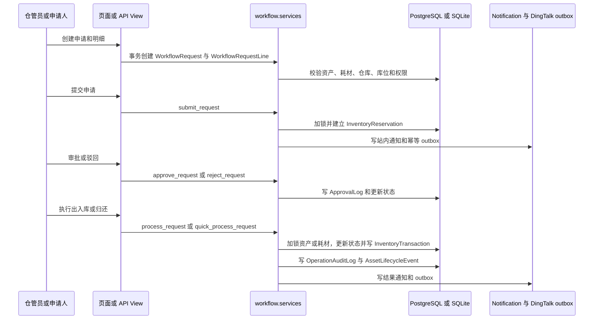
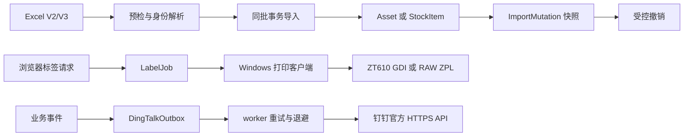

# 仓储系统第一轮全景审查报告

> 状态说明：第 1 至 19 节记录只读审查阶段的历史状态。用户授权修复后，第 20 节更新了 P1-01 的代码、迁移和本机回归状态，当前结论以第 20 节及权威状态文档为准。

审查日期为 2026-11-23。范围覆盖当前工作区代码、配置、部署脚本、自动化测试和本机 HTTP 冒烟。没有连接 NUC 业务数据库，没有修改生产配置，没有执行迁移、部署、删除或数据修复。

## 1. 执行摘要

系统是一个 Django 单体仓储管理系统，使用 Django REST Framework 提供 API，服务端模板和原生 JavaScript 提供 Web/PWA，生产拓扑为 Nginx、Gunicorn、Django、PostgreSQL，媒体和备份存放在服务器持久化目录。核心闭环为资产或耗材资料、申请、审批、预占、出入库或归还、生命周期与审计，同时覆盖采购、盘点、维修、导入导出和通知。

当前提交基线在本轮后为 `73958d65939c7f77bdb27cff947b3cad35fa7452`，工作区已验证干净。开始本轮时读取到的基线是 `a2fd9a7c782a45e568a50874ca4de8f276486272`，期间出现了一个外部提交 `73958d6`，其内容与本轮审查的 797 项自动化结果一致。该提交不是本轮创建的，报告按最终可读工作区审查，不能把它当作本轮由审查代理提交的修复。

NUC SSH 返回 `Permission denied (publickey,password)`，`/opt/after-sales-warehouse/current/release-info` 本轮无法读取，因此 NUC 实际运行 release 为“未复核”。历史文档中的服务器版本不作为本轮现场证据。

本机 Django 全量测试为 797 通过、8 跳过，系统检查、迁移漂移、pip 依赖一致性、差异格式和 JavaScript 语法通过。本机开发服务器的 `/health/`、`/login/` 和 `/sw.js` 返回 200。开发服务器提示本机 SQLite 有 19 个未应用迁移，未执行迁移以避免改变现有本机数据。

本轮没有可证实的 P0。优先处理一个影响数据完整性的 P1 和多个 P2。P1 是主数据删除的模型层约束仍可被 admin 或其他直接 ORM 路径绕过。P2 主要集中在报表全量物化、安全门禁没有自动化接入、开发配置容易被误用于部署，以及大模块维护成本。PostgreSQL 并发、真实浏览器、iPhone Safari、DS3678 和 ZT610 现场验收仍未验证。

## 2. 全局地图

### 模块划分及职责

| 模块 | 主要职责 | 关键入口 |
| --- | --- | --- |
| `apps.common` | 页面主干、权限辅助、审计、限流、健康检查、PWA service worker、系统设置 | `backend/apps/common/urls.py`、`backend/apps/common/views/legacy.py` |
| `apps.accounts` | 用户档案、账号开通申请、会话账本、令牌和账号治理 | `backend/apps/accounts/urls.py`、`backend/apps/accounts/views.py` |
| `apps.inventory` | 仓库、库位、资产、耗材、编码、盘点、组合设备和标签作业 | `backend/apps/inventory/urls.py`、`backend/apps/inventory/views.py` |
| `apps.workflow` | 申请、审批、预占、出入库、采购到货、离线复核和延期 | `backend/apps/workflow/urls.py`、`backend/apps/workflow/services.py` |
| `apps.notifications` | 站内通知、低库存状态、钉钉 outbox 和重试 | `backend/apps/notifications/views.py`、`backend/apps/notifications/outbox.py` |
| `deploy/ubuntu22` | 发布包、原子 release、备份、恢复演练、健康检查、systemd timers 和 Nginx | `deploy/ubuntu22/install.sh`、`backup.sh`、`restore-drill.sh` |

### 程序入口和启动过程

1. `backend/manage.py` 设置 `DJANGO_SETTINGS_MODULE=warehouse_backend.settings`，用于迁移、检查、测试和本机开发服务器。
2. `backend/warehouse_backend/settings.py` 读取 `backend/.env` 或服务器环境变量，建立数据库、静态文件、媒体、日志、认证和安全中间件配置。
3. `backend/warehouse_backend/urls.py` 汇总页面、认证、账户、库存、工作流和通知 API，并在 DEBUG 时挂载静态和媒体调试路由。
4. 生产由 Nginx 接收 80 或 443 流量，再代理到 `127.0.0.1:8000` 的 Gunicorn。systemd timers 触发备份、一致性巡检、健康检查、通知 outbox、低库存摘要和安全清理。

### 核心申请到出入库调用链



### 导入、标签和通知数据流



### 数据库、缓存、文件和第三方服务

- 生产数据库为 PostgreSQL，本机默认使用 `runtime-data/db.sqlite3`。Django ORM 是业务写入边界，关键状态变更集中在 workflow 和 inventory 服务层。
- 当前没有独立缓存服务。登录限流、会话账本、离线记录和通知 outbox 使用数据库或浏览器 IndexedDB。Service Worker 缓存静态资源并对易变脚本使用网络优先策略。
- 媒体由 `MEDIA_ROOT` 保存，Nginx 的 `/media/` 直接映射到服务器持久化目录。生命周期附件路径由 Nginx 特殊规则拦截后走 Django 下载视图。
- 钉钉群机器人和个人工作通知通过 outbox 异步发送，代码限制为官方 HTTPS 主机并设置超时。

### 鉴权与权限边界

- 页面使用 Django Session。API 使用时效令牌或 Session，默认权限为 `IsAuthenticated`，令牌入口在 `backend/apps/common/api_views.py`。
- `apps.common.permissions` 将录入、出入库、审批、报表、财务、导入、标签和账号治理拆为独立权限组。高风险动作在 View 层和服务层均有权限检查。
- 工作流对象按申请人、未分配待办、指定审批人和仓库状态过滤，避免普通申请人查看全量任务。
- 仍需要现场核验反向代理头、实际 Nginx 配置、管理员 admin 入口和 PostgreSQL 角色权限，当前只能确认源码边界。

### 部署拓扑和关键端口

```mermaid
flowchart TB
    B[浏览器或 PWA] -->|80/443| N[Nginx]
    N -->|127.0.0.1:8000| G[Gunicorn]
    G --> D[Django]
    D -->|5432| P[PostgreSQL]
    D --> M[/srv/after-sales-warehouse/media]
    T[systemd timers] --> S[备份、健康、一致性、outbox、清理]
    S --> P
    S --> M
```

### 失败传播和恢复路径

- 服务层业务错误转换为页面提示或 API 400。数据库竞争错误在部分 API 入口转换为 503，客户端可重试。
- outbox 领取使用状态、锁定时间和退避时间，失败保留记录并增加尝试次数。
- 发布脚本在切换 release 前执行数据库快照、依赖和静态文件检查，健康检查失败时恢复旧的 `current` 链接。恢复演练脚本已按 `media-snapshots` 格式更新，但本轮没有真实 Linux 和 PostgreSQL 实跑。
- 当前本机运行数据未完成迁移，启动仍能提供页面和健康检查，但依赖新字段的手工流程不能据此判定完整可用。

## 3. 当前环境和可运行性

### 已验证环境

| 项目 | 实际结果 | 证据等级 |
| --- | --- | --- |
| Python | 3.12.10，使用仓库 `.venv` | 已验证 |
| Django | 5.2.19 | 已验证，开发服务器启动日志 |
| 依赖 | `pip check` 无冲突 | 已验证 |
| Django 配置 | `manage.py check` 无问题 | 已验证 |
| 迁移漂移 | `makemigrations --check --dry-run` 无变化 | 已验证 |
| JavaScript | 全部静态 `.js` 文件 `node --check` 通过 | 已验证 |
| 本机 HTTP | `/health/`、`/login/`、`/sw.js` 为 200，令牌接口 GET 为 405 | 已验证 |
| 本机数据库 | SQLite 文件存在，但开发服务器提示 19 个未应用迁移 | 已验证，环境风险 |
| NUC release | SSH 认证失败，未读取 | 未复核 |
| PostgreSQL 并发 | 未连接目标数据库 | 未执行 |
| 浏览器 E2E | 未启动 Playwright 或真实浏览器 | 未执行 |
| DS3678、ZT610、iPhone Safari | 无现场设备连接 | 未执行 |

### 静态安全检查的边界

`manage.py check --deploy` 在本机开发配置下报告 HSTS、HTTPS 重定向、Secure Cookie、开发密钥和 DEBUG 共 6 项警告。这些警告证明当前本机配置不适合作为生产配置，不能推断 NUC 实际配置。Bandit 和 pip-audit 不在本机虚拟环境中，WSL Bash 也无法在当前执行环境启动，因此本轮没有静态 SAST、依赖 CVE 或 Ubuntu shell 语法的通过结论。

## 4. 已完成测试及结果

### 研发自测

| 命令 | 预期 | 实际 | 结果 | 剩余风险 |
| --- | --- | --- | --- | --- |
| `..\\.venv\\Scripts\\python.exe manage.py check` | 无配置错误 | System check identified no issues | 通过 | 只代表本机配置 |
| `..\\.venv\\Scripts\\python.exe manage.py makemigrations --check --dry-run` | 无模型漂移 | No changes detected | 通过 | 不代表服务器已迁移 |
| `..\\.venv\\Scripts\\python.exe -m pip check` | 依赖无冲突 | No broken requirements found | 通过 | 未执行 CVE 审计 |
| `git diff --check` | 无空白或冲突标记 | 无输出 | 通过 | 工作区期间发生外部提交 |
| Django 全量测试 | 全部通过 | 797 passed，8 skipped，458.314 秒 | 通过 | 8 项为 PostgreSQL 专项，仍未执行 |
| Node JavaScript 语法检查 | 脚本可解析 | 全部完成 | 通过 | 不替代浏览器交互 |
| `manage.py check --deploy` | 生产配置无警告 | 6 项本地开发配置警告 | 条件通过 | 需读取 NUC 实际环境 |

### 已设计但未执行的测试层

- 正常闭环已由 Django 测试覆盖申请、审批、预占、出入库、采购、盘点、导入、审计、通知和权限反向用例。
- PostgreSQL 层的锁竞争、审计触发器、事务隔离和并发重复提交未在本轮执行。SQLite 不能证明这些语义。
- 真实浏览器、iPhone Safari 主屏幕、相机扫码、DS3678 中文输入法和 ZT610 连续走纸未执行。
- 首次安装、重启、升级、回滚、异机恢复和 Nginx/Gunicorn/systemd 现场检查未执行。

## 5. P0/P1/P2 问题清单

### P1-01 主数据删除仍可绕过 ViewSet 守卫

- **位置** `backend/apps/inventory/models.py:129`、`backend/apps/inventory/models.py:575-576`
- **触发条件** 通过 Django admin、脚本或其他直接 ORM 路径删除被引用的仓库。
- **原因** `Location.warehouse` 使用 `CASCADE`，`Asset.warehouse` 与 `Asset.location` 使用 `SET_NULL`。当前保护主要在 `WarehouseViewSet` 和 `LocationViewSet` 的 `_assert_deletable`。
- **影响** 资产可能失去仓库和库位归属，库位历史可能被物理删除，审计和追溯发生数据缺口。
- **证据** 当前模型定义已直接确认，项目状态也明确记录模型层迁移尚未完成。ViewSet 保护不能覆盖 admin 和所有代码调用点。
- **修复建议** 将业务历史关联改为 `PROTECT` 或受控停用，增加迁移和 admin 反向用例。服务层提供统一删除或停用入口，禁止直接 `Model.delete()`。
- **验证方法** 用 API、admin、服务层和直接删除四条入口分别验证引用对象阻断、空对象删除、审计一致性和迁移回滚。
- **修复风险** `PROTECT` 迁移会暴露历史脏数据，需要先做引用盘点和恢复快照，不能直接在 NUC 执行。

### P2-01 报表和供应商历史全量物化

- **位置** `backend/apps/common/views/legacy.py:2433-2484`、`2499-2630`、`4446-4530`、`4336-4443`
- **触发条件** 访问供应商价格、供应商对账、呆滞库存或报表总览，且订单、流水或资产规模增长。
- **原因** QuerySet 被直接迭代为 Python 列表或字典，呆滞库存先构造全部 `rows` 后才用 `Paginator` 截取 50 行，供应商对账也先物化全部订单行。
- **影响** 内存峰值、响应时间和 GC 压力随历史数据线性增长。CSV 导出还会持有完整结果直到响应结束。
- **证据** 源码显示 `for line in lines`、`rows.append` 和 `Paginator(rows, 50)` 的顺序。当前没有万级或百万级 PostgreSQL 压测。
- **修复建议** 把过滤、聚合、排序和分页下推数据库，页面只取当前页，导出使用 `iterator()` 或分块响应。为日期、供应商、订单状态和流水关联建立并核对索引。
- **验证方法** 使用 1 万、10 万和 100 万行 PostgreSQL 基准，记录 P95、P99、RSS、查询计划和导出首字节时间。
- **修复风险** ORM 聚合口径和现有页面展示可能不一致，需要用固定快照对照旧结果。

### P2-02 `check-all.sh` 没有执行脚本语法和安全门禁

- **位置** `deploy/ubuntu22/check-all.sh:41-89`
- **触发条件** 修改 Ubuntu shell、依赖或安全配置后只运行一键检查。
- **原因** 当前脚本只执行 Django check、迁移检查、pip check、diff check 和可选全量测试，没有 `bash -n`、Bandit 或 pip-audit。
- **影响** shell 语法回归、已知依赖漏洞和高风险 Python 模式可能在发布前漏检，安全证据依赖人工记忆。
- **证据** 脚本正文未出现这些检查。本轮 Bandit、pip-audit、WSL Bash 均未能执行，说明门禁缺少可用性反馈。
- **修复建议** 为工具不存在提供明确的 `not installed` 结果并支持严格失败模式，将 `bash -n`、Bandit 和锁文件审计纳入 CI 或发布前检查。
- **验证方法** 人为制造 shell 语法错误、Bandit 告警和依赖审计失败，确认脚本非零退出并保留日志。
- **修复风险** 不同平台工具路径、网络访问和扫描器版本会造成误报，需要锁定工具版本与豁免文件。

### P2-03 开发环境示例仍可能被误用于生产

- **位置** `backend/.env.example:12-30`、`backend/warehouse_backend/settings.py:25-45`
- **触发条件** 运维人员直接复制 `.env.example` 到公网实例，忘记将 DEBUG、密钥和 HTTPS 相关参数改为生产值。
- **原因** 示例明确包含 `DEBUG=1` 和开发密钥，settings 在 DEBUG 下允许开发密钥和非 HTTPS Cookie。文件注释有提醒，但配置本身仍可启动。
- **影响** 可能暴露调试堆栈、使用弱密钥、允许非安全 Cookie，造成部署级安全事故。
- **证据** `check --deploy` 在本机复现 6 项安全警告。正式 install.sh 会生成更严格的 app.env，但手工部署路径仍存在人为误配置窗口。
- **修复建议** 将开发示例改为显式 `.env.local.example`，生产示例只保留占位符并让启动在 `DEBUG=0` 缺少安全配置时硬失败。README 和 preflight 使用同一套检查。
- **验证方法** 在临时目录分别加载开发和生产示例，确认开发可运行、生产缺值或弱值立即失败，并对 `check --deploy` 结果做白名单化说明。
- **修复风险** 本地新用户体验会增加配置步骤，需要提供不含秘密的生成命令。

### P2-04 大模块增加维护和回归风险

- **位置** `backend/apps/common/views/legacy.py` 约 5183 行，`backend/apps/workflow/services.py` 约 1896 行。
- **触发条件** 多人同时修改页面、报表、设置和工作流服务。
- **原因** common 仍承载大量页面和跨域辅助，workflow service 集中处理多种单据状态机。
- **影响** 变更冲突、局部回归和权限边界审查成本上升，单文件测试和代码导航困难。
- **证据** 本轮读取到的文件行数，以及多个领域路由都集中到同一 legacy 模块。当前测试虽通过，未消除演进成本。
- **修复建议** 保持 URL 兼容，按 inventory、reports、settings、workflow lifecycle 拆为内部模块，先移动代码再逐批补测试，不在稳定化阶段顺手改业务语义。
- **验证方法** 每次拆分前后运行全量测试、URL 反向解析、模板渲染和权限矩阵。
- **修复风险** 循环导入、装饰器顺序和模板反向 URL 可能受影响，必须小步提交。

## 6. 当前模块深挖

### accounts

账号开通申请、Session 账本和令牌轮换已经分层。特权账号会话上限和撤销状态存入数据库，安全事件使用摘要字段。需要在 PostgreSQL 验证并发登录上限的唯一性和锁顺序，当前 8 项 PostgreSQL 专项被跳过。

### inventory

资产以 UUID 为业务主键，`system_asset_no` 和 `asset_code` 分离，编码服务负责前缀和流水。资产状态同时保留 legacy status 与四维状态，兼容成本较高。仓库、库位和资产删除语义仍是当前最高数据完整性风险。标签作业和二维码接口已存在权限保护，ZT610 真实走纸尚未验证。

### workflow

工作流服务集中维护申请、审批、预占、出入库、采购到货和延期。主要状态动作使用事务和锁，失败以 `WorkflowError` 反馈。采购到货已增加客户端幂等键。真实 PostgreSQL 下的锁竞争、重复提交和审计触发器仍需执行。

### notifications

站内通知按 recipient 隔离，DingTalkOutbox 使用幂等键、锁定时间和退避。第三方调用有超时和官方 HTTPS 主机限制。当前缺少对真实网络超时、DNS 失败和长期失败队列积压的现场指标验证。

### common 与前端

common 提供健康检查、PWA manifest、Service Worker、缓存头、安全响应头和页面主干。M17 所需 PNG 图标和 iOS meta 已存在于 `backend/apps/common/static/warehouse/manifest.webmanifest` 与 `backend/templates/web_base.html`。扫码脚本有 composition 和 Enter/Tab 处理，但现场设备和 Safari 体验仍未执行。

### deploy

发布使用独立 release、持久化 `app.env` 和原子 current 链接。Nginx 只对生命周期附件路径做特殊拦截，其余 `/media/` 直接映射。恢复脚本已按 `media-snapshots` 结构更新，但本轮没有 Linux、PostgreSQL、快照校验和异机恢复证据。

## 7. 多角色评审意见

### 架构师

单体边界目前清晰，业务服务层和审计模型已经形成稳定核心。common 视图与 workflow 服务过大，限制后续演进。建议先固化数据删除语义和 PostgreSQL 运行基线，再进行保持 URL 兼容的内部拆分。

### 开发负责人

状态变更大多经过服务层和事务，权限函数集中且可复用。模型层删除策略与 ViewSet 策略不一致，属于容易被新入口绕过的隐性缺陷。后续改动应优先补跨入口测试，避免只增加页面测试。

### 测试负责人

SQLite 全量 797 项通过提供了较好的业务回归证据，但不能替代 PostgreSQL 锁、触发器和隔离级别测试。浏览器、硬件和恢复演练均未执行，验收表必须继续维持未验证状态。建议建立固定数据规模的报表容量基线。

### 安全负责人

API 默认认证、细粒度权限、令牌过期、CSP 和敏感字段过滤已形成基础防线。开发 `.env` 误用、媒体直读边界和 NUC 实际代理配置仍需现场确认。Bandit 和 pip-audit 本轮未运行，不能给出静态安全通过结论。

### SRE/运维

发布脚本具备快照、原子切换和健康回滚设计，systemd timer 覆盖主要运维任务。当前 SSH 认证失败导致 release、迁移、服务、Nginx 和 PostgreSQL 状态都不能复核。`check-all.sh` 应成为可重复、工具缺失可见、失败可阻断的发布门禁。

### 最终用户

仓管员的核心路径已经集中到 Web/PWA，扫码、快速出入库、审批和盘点入口可从页面代码确认。iPhone Safari 主屏幕、相机权限、中文输入法扫码和连续走纸仍没有真机证据。现场验收需要记录错误提示、等待状态、失败后继续扫描和重复提交反馈。

## 8. 改进优先级清单

1. **P1 数据完整性**。登记模型层 `PROTECT` 或统一受控停用方案，先盘点现有引用，再补迁移、admin、API、服务层和回滚验证。
2. **P1 环境基线**。在不触碰 NUC 的前提下建立独立本机测试数据库并应用全部迁移，标记现有 SQLite 数据仅用于历史查看。恢复 NUC 连接后只读读取 release、迁移和服务状态，再决定是否部署。
3. **P2 容量**。对报表、供应商价格、对账和呆滞库存做数据库聚合、分页和分块导出，完成 1 万到 100 万行压测。
4. **P2 发布门禁**。补齐 `bash -n`、Bandit、pip-audit 和工具版本记录，要求工具缺失时明确阻断或由用户确认豁免。
5. **P2 配置安全**。拆分开发和生产示例，统一 `check --deploy` 说明，禁止生产启动接受占位密钥、DEBUG 和通配 Host。
6. **P2 可维护性**。冻结 URL 和模板契约，按领域拆分大文件，每步保留全量测试和权限矩阵。
7. **现场验收**。依次完成 NUC PostgreSQL 并发、iPhone Safari PWA、DS3678 中文输入法连续扫码、ZT610 60×40 mm 连打 10 张和异机恢复演练。

## 9. 尚未验证的风险和需确认事项

- NUC 当前运行 release、数据库迁移状态、Gunicorn、Nginx、systemd timers、PostgreSQL 版本和真实环境安全变量均未复核。
- 本机 SQLite 有 19 个未应用迁移。全量测试使用临时测试库并自动迁移，不能证明现有 `runtime-data/db.sqlite3` 可直接支持当前代码。
- PostgreSQL 原始审计触发器、锁竞争、并发幂等、连接复用和数据库权限未执行。
- `backend/apps/common/static/warehouse/manifest.webmanifest` 和 PNG 图标已存在，但 iPhone Safari 添加到主屏幕和 standalone 行为未现场验证。
- Nginx 对 `/media/` 的公开映射是否符合资产照片、费用凭证和品牌资源的业务分类要求，需要业务确认。生命周期附件路径已有单独拦截规则。
- Bandit、pip-audit 和 WSL shell 检查因本机工具缺失或不可启动未执行。不能引用历史报告作为本轮通过证据。
- 当前提交基线与 `PROJECT_STATUS.md` 顶部记录的 `a2fd9a7` 不一致，状态文档仍写着未提交工作区，需在下一次状态更新中校正三态版本记录。

## 10. 下一阶段计划

1. 在本地建立隔离测试数据库副本并应用全部迁移，只读核对迁移顺序、0022 幂等键和现有测试数据兼容性。
2. 先修复并验证主数据删除的模型层约束，覆盖 admin、API、服务层和直接 ORM 反向路径。
3. 完成报表和供应商路径的 PostgreSQL 容量基线，输出查询计划、RSS、P95、P99 和导出吞吐。
4. 恢复 NUC 只读连接后记录 release-info、迁移、服务和健康检查，不使用历史版本替代现场结果。
5. 在用户明确“开始修复”前保持业务代码不变。获得确认后按 P1、P2 顺序小步修改，每步执行专项测试、全量测试、`check`、迁移漂移和差异检查。

### 本轮结束状态

- 已完成 代码和配置全景盘点、核心调用链与数据流梳理、基础静态检查、本机全量 Django 回归、本机 HTTP 冒烟和第一批问题清单。
- 测试结果 797/797 通过、8 跳过。`check`、迁移漂移、pip check、diff check 和 JavaScript 语法通过。`check --deploy` 有 6 项本地配置警告。
- 阻塞项 NUC SSH 认证失败、19 个本机未应用迁移、PostgreSQL/真实浏览器/设备/恢复演练未执行、Bandit/pip-audit/WSL shell 不可用。
- 下一模块 报表容量和主数据删除跨入口验证，随后是 NUC 只读运行状态复核和现场验收准备。

## 11. 第二轮复核：删除跨入口与报表容量

### 11.1 版本和执行边界

- Git 已提交基线仍为 `73958d65939c7f77bdb27cff947b3cad35fa7452`。
- 本地未提交文件为 `CHANGELOG.md`、`PROJECT_STATUS.md` 和本报告，均属于本轮审查记录。
- NUC SSH 仍返回 `Permission denied (publickey,password)`，实际运行 release 未复核。
- 本轮没有修改业务代码，没有执行迁移，没有访问 NUC 数据库，没有执行生产 admin 操作。

### 11.2 主数据删除跨入口验证

源码反射确认结果如下。

| 检查项 | 结果 | 证据 |
| --- | --- | --- |
| `Location.warehouse` 删除策略 | `CASCADE` | `manage.py shell` 读取模型元数据 |
| `Asset.warehouse` 删除策略 | `SET_NULL` | `manage.py shell` 读取模型元数据 |
| `Asset.location` 删除策略 | `SET_NULL` | `manage.py shell` 读取模型元数据 |
| `WarehouseAdmin` 覆盖删除保护 | 否 | `delete_model` 不在类字典中 |
| `LocationAdmin` 覆盖删除保护 | 否 | `delete_model` 不在类字典中 |
| admin 基类行为 | 先写删除审计，再直接 `super().delete_model()` | `backend/apps/common/admin.py:39-51` |
| API 删除保护 | 有 | `backend/apps/inventory/views.py:150-206` |

这形成了明确的跨入口不一致。API 的 `WarehouseViewSet` 和 `LocationViewSet` 会检查资产、耗材、库位引用并返回 400，但 admin 继承通用删除行为。只要 admin 用户有删除权限，删除在用仓库就可能依赖数据库的 `CASCADE/SET_NULL` 继续执行，产生仓库被删、库位被级联删除、资产仓库和库位字段被清空的结果。删除审计还可能记录“已删除”，但没有保存与 API 一致的删除前完整快照和事务化保护。

本轮对 `apps.inventory.test_master_data_delete` 和 `apps.common.test_deployment_security` 执行专项测试，结果为 **16/16 通过**。这些用例覆盖 API 入口和部署脚本静态契约，当前没有覆盖 admin 删除入口，因此不能把专项通过解释为跨入口风险已关闭。

### 11.3 报表容量路径细化

#### 供应商价格历史

- `backend/apps/common/views/legacy.py:2433-2450` 生成 `PurchaseOrderLine` QuerySet。
- `:2467-2484` 逐行构建 `groups` 字典，并为每个供应商和物品保存完整明细列表。
- 供应商筛选字段 `supplier_snapshot`、`name_snapshot`、`code_snapshot` 没有在 `PurchaseOrderLine.Meta` 中定义专用索引。订单状态和日期过滤位于关联的 `PurchaseOrder` 表。
- 页面分页不存在，结果规模与所有有效采购明细成正比。CSV 导出 `:2509-2530` 继续逐行遍历完整 QuerySet。

#### 供应商对账

- `backend/apps/common/views/legacy.py:2535-2579` 首先用 `list(...)` 物化全部订单明细。
- 供应商和日期筛选在 Python 列表上执行，收货日期模式再物化全部收货明细到 `period_receipts` 字典。
- `:2587-2632` 以 Python 字典聚合供应商，`lines` 列表保留每条明细的展示结构。页面没有数据库级分页。

#### 呆滞库存

- `backend/apps/common/views/legacy.py:4446-4530` 分别查询全部在库资产和正库存耗材，逐行计算最后活动日期和闲置天数。
- `:4534-4545` 在完整 `rows` 构建后才调用 `Paginator(rows, 50)`，因此页面分页不能降低数据库读取和 Python 内存峰值。
- 成本汇总 `total_cost` 也再次遍历完整 `rows`。

#### 报表总览

- `backend/apps/common/views/legacy.py:4337-4443` 已将时间序列成本和计数聚合下推到数据库，但 `:4380` 又逐行迭代 `transactions` 生成 `action_counts`。
- 当前 `InventoryTransaction` 有 `business_date`、`action/business_date` 索引，属于较好的基础。仍需 PostgreSQL `EXPLAIN` 验证关联仓库、项目和工单筛选的计划。
- 财务用户的当前库存成本在 `:4427-4434` 逐个读取资产和耗材后在 Python 求和，规模增长时会增加响应时间。

本轮没有伪造大数据量基准，也没有访问 PostgreSQL，因此以上属于代码已验证、高概率容量风险。需要在隔离 PostgreSQL 中以 1 万、10 万和 100 万条采购明细、收货明细、资产和流水测量 P95、P99、RSS、查询计划和导出首字节时间。

### 11.4 第二轮问题更新

#### P1-01 证据升级：删除保护只覆盖 API

- **位置** `backend/apps/common/admin.py:39-51`、`backend/apps/inventory/admin.py:274-286`、`backend/apps/inventory/models.py:129`、`575-576`
- **触发条件** 系统管理员通过 Django admin 删除在用仓库或库位。
- **原因** admin 没有重写删除权限或删除方法，通用基类直接删除。模型关系仍为 `CASCADE/SET_NULL`。
- **影响** API 测试通过不能阻止 admin 或脚本路径造成资产脱仓和库位历史丢失。
- **证据** 模型元数据反射得到 `CASCADE/SET_NULL`，`WarehouseAdmin.__dict__` 和 `LocationAdmin.__dict__` 均没有 `delete_model`，专项测试没有 admin 用例。
- **修复建议** 首选模型层 `PROTECT` 加受控停用，admin 删除按钮同时按引用隐藏或返回业务错误。删除审计统一事务化并保存快照。
- **验证方法** 在 Django 测试数据库覆盖 admin GET 删除确认页、POST 删除、批量删除、API 删除、直接服务调用和空对象删除。
- **修复风险** 迁移前需盘点已有引用，避免上线后迁移失败。

#### P2-04 证据升级：报表路径未按结果集规模受控

- **位置** `backend/apps/common/views/legacy.py:2433-2649`、`:4446-4540`、`:4427-4434`
- **触发条件** 采购明细、收货明细、资产或流水达到万级以上，或用户导出长时间范围。
- **原因** 供应商价格和对账先全量物化后分组，呆滞库存先全量构建列表后分页，当前库存成本逐行求和。
- **影响** 内存和延迟随数据量线性增长，多个并发报表请求可能放大 Gunicorn worker 内存压力。
- **证据** 源码中的 `list(...)`、Python 字典分组和 `Paginator(rows, 50)` 顺序已确认。无目标 PostgreSQL 压测证据。
- **修复建议** 把筛选、聚合、排序和分页下推数据库，导出使用 `iterator()` 或分块响应，补供应商和日期相关索引并用查询计划确认。
- **验证方法** 固定数据集比较旧口径与新 SQL 口径，同时记录 P95、P99、RSS、数据库缓冲命中和导出首字节时间。
- **修复风险** 聚合口径、空供应商、日期基准和成本权限需要逐字段对照现有页面和 CSV。

### 11.5 第二轮结束状态

- 已完成 admin、API、模型删除边界的静态和元数据交叉验证，完成供应商价格、供应商对账、呆滞库存和报表总览的容量路径定位。
- 专项测试结果为 16/16 通过。它们证明 API 删除保护和部署契约当前通过，未覆盖 admin 删除。
- 阻塞项保持不变。NUC release、PostgreSQL、真实浏览器、设备和恢复演练未验证。
- 下一模块优先为 admin 删除反向测试设计、报表查询计划和 PostgreSQL 隔离容量基准。获得“开始修复”前继续保持业务代码不变。

## 12. 第三轮复核：admin 删除实证与查询索引

### 12.1 版本和执行边界

- Git 已提交基线仍为 `73958d65939c7f77bdb27cff947b3cad35fa7452`。
- 本地未提交文件仍为 `CHANGELOG.md`、`PROJECT_STATUS.md` 和本报告，均属于审查记录。
- NUC SSH 认证仍失败，实际运行 release 未复核。
- 临时测试文件 `backend/apps/inventory/test_admin_delete_probe.py` 只用于本轮测试，执行后已删除。业务代码、生产数据库和本机持久化数据库均未修改。

### 12.2 admin 删除路径实证

在临时 Django 测试数据库中创建一个有库位和资产引用的仓库，直接调用已注册的 `WarehouseAdmin.delete_model()`。专项结果为 **1/1 通过**，行为如下。

1. 仓库被删除。
2. `Location.warehouse=CASCADE` 导致库位被删除。
3. `Asset.warehouse=SET_NULL` 和 `Asset.location=SET_NULL` 导致资产归属字段被置空。
4. 通用 admin 基类写入 `warehouse_admin_deleted` 审计记录。

这把第二轮的模型和源码推断升级为已验证的跨入口数据完整性缺陷。API 的 `WarehouseViewSet._assert_deletable()` 不能覆盖 admin 的 `delete_model()`，审计记录也没有阻止破坏性删除。

### 12.3 报表查询和索引证据

通过 Django 模型元数据和 QuerySet SQL 只读检查得到以下结果。

| 模型 | 自定义索引 | 关键查询特征 |
| --- | --- | --- |
| `PurchaseOrderLine` | 无 | 连接 `PurchaseOrder`，按订单状态过滤，按 `supplier_snapshot` 和 `order__order_date` 排序 |
| `PurchaseReceiptLine` | 无 | 连接收货单、订单明细和采购单，按采购单状态过滤 |
| `InventoryTransaction` | `business_date`、`action/business_date` | 有时间和动作索引，仍需 PostgreSQL 计划验证 |
| `Asset` | 无自定义索引 | 呆滞库存按状态、流水日期聚合，并关联仓库、库位和物品类型 |
| `StockItem` | 无自定义索引 | 呆滞库存按数量和关联对象过滤 |

供应商价格查询生成的 SQL 在订单明细和采购单之间连接，订单状态位于采购单，排序位于明细供应商快照和采购日期。供应商对账的收货模式额外连接收货明细、收货单和订单明细。当前没有 PostgreSQL `EXPLAIN ANALYZE`、大数据量响应时间或内存采样，因此索引是否需要增加仍需容量基准确认，代码层的全量物化风险已经确认。

### 12.4 问题状态升级

#### P1-01 主数据删除跨入口破坏数据完整性（已实证）

- **位置** `backend/apps/common/admin.py:39-51`、`backend/apps/inventory/admin.py:274-286`、`backend/apps/inventory/models.py:129`、`575-576`
- **触发条件** 具备 admin 删除权限的账号删除仍被资产或库位引用的仓库。
- **原因** admin 继承通用删除方法，模型层使用 `CASCADE/SET_NULL`，API 守卫不在共享模型或 admin 层生效。
- **影响** 仓库和库位历史消失，资产的仓库和库位外键被清空，后续台账和生命周期追溯无法恢复原归属。
- **证据** 临时 Django 测试 `1/1` 通过并直接观察到仓库、库位删除和资产外键清空，同时生成删除审计记录。
- **修复建议** 先做引用盘点和快照，再将业务历史关联改为 `PROTECT` 或统一受控停用。admin 删除入口隐藏或返回业务错误，审计写入与受控动作放在同一事务。
- **验证方法** API、admin 单条删除、admin 批量删除、服务层和直接 ORM 入口分别覆盖在用对象、空对象、审计一致性和回滚。
- **修复风险** 迁移可能因既有引用失败，必须先在隔离数据库演练并保留可恢复快照。

#### P2-04 报表容量风险（索引证据补充）

- **位置** `backend/apps/workflow/models.py:322-423`、`backend/apps/common/views/legacy.py:2433-2649`、`:4446-4540`
- **触发条件** 采购明细、收货明细、资产或流水规模增长，或多个用户并发访问长时间范围报表。
- **原因** 采购明细和收货明细没有自定义索引，视图又在 Python 中全量分组、聚合和分页。
- **影响** 数据库扫描、连接排序、Python 内存和 Gunicorn worker 压力随数据规模增长。
- **证据** 模型元数据显示两类采购明细无自定义索引，QuerySet SQL 显示跨表连接、状态过滤和排序。未执行 PostgreSQL 计划与压力测试。
- **修复建议** 先用真实数据分布评估索引，再将日期、状态和供应商聚合下推数据库，分页和导出采用分块处理。
- **验证方法** 对 1 万、10 万和 100 万行执行 `EXPLAIN (ANALYZE, BUFFERS)`，记录响应 P95/P99、RSS、数据库临时空间和 CSV 首字节时间。
- **修复风险** 新索引会增加写入和迁移时间，SQL 聚合重写可能改变空值、日期基准和成本权限口径。

### 12.5 第三轮结束状态

- 已完成 admin 删除路径的临时数据库实证，确认 P1-01 是可复现数据完整性缺陷。
- 已完成采购明细、收货明细、库存流水、资产和耗材模型索引清点，并保存关键 QuerySet SQL 证据。
- 测试结果为 admin 探针 `1/1`，前一轮删除与部署专项仍为 `16/16`，全量 Django 回归仍为 `797/797`、8 项跳过。
- 临时测试文件已删除，工作区没有新增测试产物。下一模块为发布安全门禁、迁移一致性和真实 Linux/PostgreSQL 验收准备。

## 13. 第四轮复核：发布门禁、迁移链与回滚边界

### 13.1 版本和执行边界

- Git 已提交基线仍为 `73958d65939c7f77bdb27cff947b3cad35fa7452`。
- 本地未提交文件为 `CHANGELOG.md`、`PROJECT_STATUS.md` 和本报告。
- NUC SSH 认证失败，实际运行 release 未复核。
- 本轮只读检查了发布脚本、迁移文件、依赖锁和服务单元，没有执行迁移、构建发布包、部署或生产数据库操作。

### 13.2 本机迁移状态

`manage.py showmigrations --plan` 在当前 `runtime-data/db.sqlite3` 上显示 **19 个未应用迁移**，包括 accounts 0004-0007、common 0012-0016、inventory 0027-0031、notifications 0005-0006 和 workflow 0020-0022。Django 测试数据库会自动应用完整迁移，因此全量测试通过不能代表本机持久化数据库已达到当前代码的 schema。

迁移目录共 87 个 Python 文件，静态清点发现 18 个 `RunPython` 数据迁移。代表性迁移包括：

- `backend/apps/inventory/migrations/0020_asset_system_asset_no.py` 为历史资产补发系统编号。
- `backend/apps/inventory/migrations/0021_asset_status_dimensions.py` 将旧状态回填到四维状态。
- `backend/apps/workflow/migrations/0009_inventorytransaction_business_date_and_more.py` 回填业务日期、库存编号和流水日期。
- `backend/apps/workflow/migrations/0011_returnreminderlog_stockitemloan_inventoryreservation_and_more.py` 回填预占和借用记录。
- `backend/apps/inventory/migrations/0027_source_sc_prefix.py` 会写入型号前缀和基础资料。

这些迁移具有数据规模、锁时间和既有脏数据兼容性影响。部分迁移使用 `migrations.RunPython.noop` 或自定义 no-op reverse，逆向操作不会恢复原数据。

### 13.3 发布和回滚边界

- `deploy/ubuntu22/install.sh:260-280` 在已有数据库时先执行 PostgreSQL 快照。
- `install.sh:470-476` 在候选 release 上执行 `migrate --noinput`，然后切换 `current` 指针。
- `deploy/ubuntu22/rollback.sh:11-16` 明确说明只切换程序 release，不回滚 PostgreSQL 数据或 schema。
- `rollback.sh:84-113` 回滚前执行备份，切换后只运行 Django check 和 `/health/`，没有验证目标代码与当前 schema 的兼容矩阵。

因此，迁移成功后再回滚旧代码，只有在旧代码能够兼容新增 schema 时才安全。涉及字段删除、约束收紧、触发器或数据语义变化的版本，代码指针回滚无法还原数据库状态。当前脚本文档已经说明这一点，但发布门禁没有自动检查目标 release 的迁移兼容性。

### 13.4 发布安全门禁

#### `check-all.sh`

`deploy/ubuntu22/check-all.sh:41-89` 只执行 Django check、迁移漂移、pip check、diff check 和全量测试。脚本正文没有 `bash -n`、Bandit、pip-audit 或测试目录退出清理。它创建 `.test-run-temp`，但没有 `trap` 或结尾删除，重复运行可能留下测试产物。

#### `security-check.sh`

`deploy/ubuntu22/security-check.sh:82-92` 在 pip-audit 未安装时只输出提醒，安装后发现漏洞也调用 `warn`，不会增加阻断项。`manage.py check --deploy` 的失败同样被转成提醒。当前服务器安全检查因此不能作为严格的依赖和部署阻断门。

#### 一次性 SQLite 导入

`deploy/ubuntu22/install.sh:464-476` 将完整 `dumpdata` 输出写入固定 `/tmp/after-sales-warehouse-initial.json`。脚本没有显式设置 `umask`、没有 `mktemp` 私有路径，也没有 `trap` 确保 dumpdata 或 loaddata 中途失败后清理。该文件包含业务数据，失败窗口可能在共享临时目录中留下可读副本。

### 13.5 依赖锁和 Linux 工具可用性

- `backend/requirements-linux.txt` 通过 `-r requirements-lock.txt` 引入锁定版本。
- `requirements-lock.txt` 为无 BOM 的 UTF-8 文本，本轮读取头部字节确认没有 UTF-16 或 UTF-8 BOM。
- 当前本机没有 Bandit 或 pip-audit。`bash.exe` 和 `wsl.exe` 指向 Windows/WSL 启动器，但执行 Bash 检查时没有可用 Linux shell，因此本轮不能把 Ubuntu 脚本语法标记为通过。
- 没有在全新 Python 3.12 环境重新安装 Linux 锁文件。现有 `.venv` 的 `pip check` 通过，不能代替全新环境安装验证。

### 13.6 第四轮问题清单

#### P2-06 证据升级：发布安全门禁不会严格阻断

- **位置** `deploy/ubuntu22/check-all.sh:41-89`、`deploy/ubuntu22/security-check.sh:72-92`
- **触发条件** 发布前工具缺失、依赖存在漏洞、部署配置出现 `check --deploy` 问题或 shell 脚本语法回归。
- **原因** 一键检查没有 shell/SAST/依赖扫描，服务器安全脚本对缺少或发现 pip-audit 问题只告警。
- **影响** 发布流程可能在没有安全扫描证据时继续，安全门禁状态依赖人工记忆和历史记录。
- **证据** 静态读取脚本确认缺少对应命令，当前本机 Bandit、pip-audit 和 Linux Bash 均未能运行。
- **修复建议** 将工具版本和扫描命令纳入可复现门禁，工具缺失时明确失败。对 `check --deploy` 设计受控白名单，公网配置不允许静默降级为提醒。
- **验证方法** 注入 shell 语法错误、Bandit 告警、依赖漏洞和工具缺失，确认脚本返回非零并输出可审计日志。
- **修复风险** 网络不可用和扫描器误报会影响发布，需要锁定工具版本和维护豁免说明。

#### P2-09 证据升级：一次性导入临时文件暴露窗口

- **位置** `deploy/ubuntu22/install.sh:464-476`
- **触发条件** 使用 `--import-sqlite`，且 dumpdata 或 loaddata 中途失败、进程被终止或服务器重启。
- **原因** 完整业务 dump 固定写入公共 `/tmp` 路径，没有私有临时文件、显式 600 权限和退出清理。
- **影响** 业务数据可能残留在临时目录，下一次运行也可能误读旧文件。
- **证据** 源码直接使用固定路径重定向，删除只发生在 loaddata 成功之后。
- **修复建议** 使用 `install` 创建 600 权限的私有临时目录，登记路径变量并设置 `trap` 清理。导入前后校验文件所有者、大小和一次性标记。
- **验证方法** 模拟 dumpdata 失败、loaddata 失败、SIGTERM 和重复执行，确认文件始终清理且不会重复导入。
- **修复风险** 清理过早会导致重试无法继续，需要把一次性标记和 dump 文件生命周期绑定。

#### P2-13 数据库迁移与代码回滚兼容性未自动验证

- **位置** `backend/apps/*/migrations/`、`deploy/ubuntu22/install.sh:470-476`、`deploy/ubuntu22/rollback.sh:11-16`
- **触发条件** 数据库已应用新迁移后，回滚到旧 release，或迁移中途失败后切换代码。
- **原因** 多个迁移包含数据回填、基础资料写入或 no-op reverse，回滚脚本只切换代码指针，不检查 schema 兼容性。
- **影响** 旧代码可能读取不到预期数据、遇到新约束或触发器，业务恢复依赖人工判断和完整数据库恢复。
- **证据** 迁移静态清点得到 18 个 `RunPython`，回滚脚本明确 `database_rollback=not_performed`。本机 SQLite 仍有 19 个未应用迁移，未完成真实升级回滚演练。
- **修复建议** 为每个发布版本维护 forward-only schema 兼容矩阵，拆分破坏性迁移为 expand/migrate/contract 阶段。回滚前执行目标 release 的 `check`、迁移兼容检查和只读冒烟。
- **验证方法** 在隔离 PostgreSQL 上从上一版本升级到候选版本，执行迁移、冒烟、代码回切和恢复演练，记录 schema 与业务计数。
- **修复风险** 增加发布步骤和保留周期，需要明确何时只能走数据库恢复而不能使用代码回滚。

### 13.7 第四轮结束状态

- 已完成发布脚本、服务器安全检查、依赖锁、迁移链和回滚边界的只读复核。
- 当前本机持久化 SQLite 有 19 个未应用迁移，未执行迁移以保护现有数据。
- 未执行 Linux Bash、Bandit、pip-audit、全新 Python 3.12 安装、PostgreSQL 迁移升级回滚或 NUC 现场验收。
- 下一模块为在隔离环境建立 Linux/PostgreSQL 验收矩阵和迁移兼容性演练，随后等待用户确认是否开始修复 P1/P2。

## 14. 第五轮复核：空库迁移链演练

### 14.1 版本和执行边界

- Git 已提交基线仍为 `73958d65939c7f77bdb27cff947b3cad35fa7452`。
- 本地未提交文件为 `CHANGELOG.md`、`PROJECT_STATUS.md` 和本报告。
- NUC SSH 认证失败，实际运行 release 未复核。
- 演练使用新建临时 SQLite 文件，不读取或修改现有 `runtime-data/db.sqlite3`，不连接 PostgreSQL，不执行部署。

### 14.2 演练步骤和结果

1. 创建临时 `runtime-data/review-migration.sqlite3`。
2. 使用仓库 `.venv` 的 Python 3.12.10 设置 `DB_ENGINE=django.db.backends.sqlite3` 和临时数据库路径。
3. 执行完整 `manage.py migrate --noinput`。
4. 执行 `manage.py check`。
5. 进程输出 `migration_chain=applied`，系统检查为 `System check identified no issues (0 silenced)`。
6. Django 连接在脚本退出前仍持有 SQLite 文件，第一次自动清理遇到 Windows `WinError 32`。进程退出后已手动删除临时数据库，探针文件也已删除，工作区无残留。

这证明当前迁移图从空 SQLite 数据库可以完成应用，不能证明 19 个未应用迁移在现有本机数据或目标 PostgreSQL 上安全。数据回填规模、锁等待、触发器、索引创建时间、约束冲突和代码回滚兼容性仍未验证。

### 14.3 验证状态更新

- **已验证**：空 SQLite 数据库完整迁移链可应用，迁移后 Django system check 通过。
- **高概率推断**：迁移文件依赖图和基本操作顺序可被 Django 执行。
- **需确认**：目标 PostgreSQL 真实数据迁移、并发锁、备份恢复、迁移失败恢复、forward-only 发布和旧代码回切。

### 14.4 第五轮结束状态

- 新增自动化演练结果为临时空库迁移成功，未改变业务代码和现有数据。
- P2-13 仍未关闭，因为代码 release 回滚与数据库 schema 回滚没有真实隔离 PostgreSQL 证据。
- 下一模块为设计 PostgreSQL 隔离库升级、回切和恢复演练矩阵。若用户回复“开始修复”，再按 P1-01、P2-06、P2-09、P2-13 优先级修改。

## 15. 第六轮复核：PostgreSQL 隔离验收准备

### 15.1 版本和执行边界

- Git 已提交基线仍为 `73958d65939c7f77bdb27cff947b3cad35fa7452`。
- 本地未提交文件为 `CHANGELOG.md`、`PROJECT_STATUS.md` 和本报告。
- NUC SSH 认证失败，实际运行 release 未复核。
- 本机未发现 `psql`、`pg_dump`、`pg_isready`、Docker 或 Podman，因此没有启动本地 PostgreSQL，也没有连接 NUC。

### 15.2 PostgreSQL 专项执行结果

执行以下专项标签：

```text
apps.accounts.test_postgresql_concurrency
apps.workflow.test_postgresql_concurrency
apps.common.test_postgresql_concurrency
apps.common.test_postgresql_audit_immutability
```

本机 SQLite 结果为 **8/8 skipped**，耗时约 0 秒。跳过原因是测试使用 `skipUnless(connection.vendor == 'postgresql')`。这证明测试选择器和跳过条件生效，不能证明行锁、并发计数或 PostgreSQL 审计触发器通过。

### 15.3 服务器并发脚本安全边界

`deploy/ubuntu22/run-concurrency-tests.sh` 已具备以下保护。

- 必须以 root 运行，并从当前 release 的环境文件读取数据库配置。
- 只允许 `django.db.backends.postgresql`。
- 数据库名和账号必须匹配安全标识符格式，避免把标识符直接拼接到 SQL 时发生注入。
- 测试库使用 `test_<DB_NAME>`，不直接在业务库执行测试数据写入。
- 如果应用账号没有 `CREATEDB`，脚本临时授予后在退出清理函数中恢复 `NOCREATEDB`。
- `trap cleanup EXIT` 会终止测试库连接、删除测试库并恢复角色权限。

脚本目前没有将 `SIGKILL`、主机断电或 PostgreSQL 服务崩溃纳入恢复验证。角色临时提权和测试库清理仍需在现场演练后检查。

### 15.4 可执行的 NUC/PostgreSQL 验收矩阵

| 阶段 | 操作 | 通过标准 | 当前状态 |
| --- | --- | --- | --- |
| 连接 | 读取 `/opt/after-sales-warehouse/current/release-info` | release、revision、脏状态可追溯 | 未执行，SSH 认证失败 |
| 快照 | 执行部署前 PostgreSQL `pg_dump` 并校验 SHA-256 | 快照文件和清单存在 | 未执行 |
| 迁移预检 | 在隔离库执行 `migrate --plan` | 计划与候选包一致 | 未执行 |
| 迁移 | 在隔离 PostgreSQL 库执行 `migrate --noinput` | 全部迁移成功，无锁超时或约束错误 | 未执行 |
| 并发 | `/usr/local/sbin/after-sales-warehouse-concurrency-test` | PostgreSQL 专项全部通过，临时库销毁，应用账号建库权限恢复 | 未执行 |
| 业务冒烟 | `smoke_business_flows --rollback` | 采购、审批、出入库、盘点、导入撤销、离线幂等全部通过，业务计数回到执行前 | 未执行 |
| 恢复 | `after-sales-warehouse-restore-drill` | 临时恢复库可读，用户、资产、审计计数合理，临时库清理 | 未执行 |
| 回切 | 切换上一 release | 目标代码 `check`、健康检查和只读页面通过，数据库兼容性有记录 | 未执行 |
| 服务 | systemd、Nginx、静态文件和 `/health/` | 服务 active，健康 200，迁移状态完整 | 未执行 |

### 15.5 现场操作顺序约束

1. 先读取 release-info 和当前数据库计数，不修改业务数据。
2. 再做 PostgreSQL 快照，快照失败停止后续动作。
3. 在隔离测试库应用迁移和执行并发专项。
4. 在当前数据库使用 `--rollback` 业务冒烟，记录执行前后计数。
5. 仅在以上结果可追溯时部署候选 release。
6. 部署后重新检查迁移、服务、健康检查和业务计数。
7. 需要代码回切时先确认目标 release 与 forward schema 兼容，数据库恢复另行执行。

### 15.6 第六轮结束状态

- 已验证本机 PostgreSQL 工具不可用，PostgreSQL 专项 `8/8` 明确跳过。
- 已静态确认服务器并发脚本的 PostgreSQL 限制、临时库、权限恢复和退出清理逻辑。
- 已建立可执行的 NUC/PostgreSQL/迁移/恢复/回切验收矩阵。
- 未连接 NUC、未启动 PostgreSQL、未执行部署或生产数据库写入。下一步需要恢复现场连接，或用户确认开始本地代码修复。

## 16. 第七轮复核：页面鉴权与响应安全边界

### 16.1 版本和执行边界

- Git 已提交基线仍为 `73958d65939c7f77bdb27cff947b3cad35fa7452`。
- 本地未提交文件为 `CHANGELOG.md`、`PROJECT_STATUS.md` 和本报告。
- NUC SSH 认证失败，实际运行 release 未复核。
- 本轮只读检查页面路由、视图装饰器、API 权限、响应安全头和缓存策略。

### 16.2 页面入口鉴权矩阵

静态对照 `backend/apps/common/urls.py` 和 `backend/apps/common/views/legacy.py` 得到以下边界。

| 入口类型 | 当前保护 | 结论 |
| --- | --- | --- |
| 登录、账号申请 | 登录页和账号申请公开，POST 受 CSRF | 符合预期 |
| `/health/` | 公开，仅返回服务和数据库状态 | 适合作为反向代理健康探针 |
| `/sw.js`、静态 manifest | 公开，响应 no-cache 或静态缓存 | 符合浏览器注册要求 |
| 工作台、资产检索、申请、借用 | `@login_required` | 已保护 |
| 库存、采购、报表、导入、标签 | `@role_required` 细分权限 | 已保护 |
| 账号、审计、一致性和系统设置 | 管理员或账号复核权限 | 已保护 |
| 退出登录 | 登录后仅 POST 执行状态变化，GET 重定向 | 已保护 |
| API `me`、通知、工作流 | DRF `IsAuthenticated` 或细分权限 | 已保护 |
| API 资产生命周期 | `IsWarehouseOperator` | 已修复并保持一致 |

`AssetViewSet` 的 list、retrieve、lookup、search 和二维码查询允许已登录用户访问，但无仓库业务角色时使用 `AssetPublicSerializer`，仅返回申请所需最小字段。生命周期 action 单独要求仓库业务权限。该边界与页面侧权限谓词一致。

### 16.3 响应安全和缓存

- `SecurityHeadersMiddleware` 设置同源 CSP、`frame-ancestors 'none'`、`object-src 'none'`、同源 Referrer Policy 和受限 Permissions Policy。
- `NoStoreHtmlMiddleware` 对 HTML 设置 `no-store`，首次响应使用 `Clear-Site-Data: "cache"` 清理旧页面缓存。
- Service Worker 只缓存静态资源，`scanner.js` 和 `offline.js` 使用网络优先，Service Worker 版本根据静态文件 mtime 生成。
- 退出登录视图只接受 POST，避免 GET 触发会话撤销和审计写入。
- `apps.common.test_cache_headers` 专项测试结果为 **10/10 通过**，覆盖缓存头、CSP、Permissions Policy、Service Worker、扫码脚本更新和离线清理。

### 16.4 残余安全观察

#### P2-14 CSP 仍允许 `unsafe-inline`

- **位置** `backend/apps/common/middleware.py:14-22`、`backend/templates/web_base.html`、登录模板和多个业务模板内联脚本/样式。
- **触发条件** 页面存在可利用的 HTML 注入或模板输出错误时，内联脚本策略允许浏览器执行注入的脚本。
- **原因** 当前 CSP 的 `script-src` 和 `style-src` 同时包含 `unsafe-inline`，用于兼容大量模板内联代码。
- **影响** CSP 对 XSS 的纵深防护能力弱于 nonce 或 hash 策略。当前测试证明策略存在，不证明内联脚本可安全信任。
- **证据** 中间件字面量包含 `script-src 'self' 'unsafe-inline'` 和 `style-src 'self' 'unsafe-inline'`，模板中存在大量内联代码。
- **修复建议** 先把全局内联脚本和样式迁移到静态资源，再为少量必要内联代码使用请求级 nonce 或固定 hash。保持 `connect-src 'self'`、`object-src 'none'` 和 `frame-ancestors 'none'`。
- **验证方法** 使用浏览器 CSP 报告模式和 XSS 负向用例，确认无内联违规、无外部脚本加载和业务扫码功能不回归。
- **修复风险** 模板迁移可能影响 HTMX 替换后的事件绑定、PWA 注册和扫码初始化，需要按页面逐批迁移。

### 16.5 第七轮结束状态

- 页面路由、视图装饰器和 API 权限边界完成静态对照，未发现新的未鉴权业务页面。
- 缓存和响应安全专项 `10/10` 通过。
- P2-14 作为 CSP 加固项登记，未修改模板或中间件。
- 未连接 NUC、未执行浏览器真机回归、未部署。下一模块为最终问题去重、优先级汇总和用户确认后的修复入口。

## 17. 第八轮复核：媒体、附件和上传边界

### 17.1 版本和执行边界

- Git 已提交基线仍为 `73958d65939c7f77bdb27cff947b3cad35fa7452`。
- 本地未提交文件为 `CHANGELOG.md`、`PROJECT_STATUS.md` 和本报告。
- NUC SSH 认证失败，实际运行 release 未复核。
- 本轮未上传到生产媒体目录，未访问 NUC 文件系统，所有测试使用临时测试数据库和临时目录。

### 17.2 附件访问边界

- 归档附件路径为 `assets/<system_asset_no>/archive/...`，Nginx 对该路径单独返回 404。
- Django 下载视图 `asset_attachment_download()` 要求 `is_warehouse_operator`，并使用 `FileResponse(as_attachment=True)`。
- 附件上传使用后缀白名单、大小限制和图片内容校验，图片会解码后重新编码。`MAX_ATTACHMENT_SIZE` 与 Nginx `client_max_body_size` 均为 100 MB。
- 现有测试覆盖仓库操作员下载成功、普通员工 404、附件归档审计和 Nginx 私有路径规则。

### 17.3 资产照片边界

- `Asset.photo_url` 是普通字符字段，管理员上传后保存为默认存储 URL。
- `AssetPublicSerializer` 对所有已登录用户返回 `photo_url`，普通用户仍可获得照片地址。
- Nginx 对普通 `/media/` 使用直接 `alias /srv/after-sales-warehouse/media/`，只有归档附件路径被拦截。因此资产照片如果位于默认媒体目录，知道 URL 的匿名客户端可能直接读取，代码没有 Django 权限检查。
- 该行为是否符合业务要求需要确认。归档附件已经受控下载，资产照片的保密级别尚未形成一致规则。

### 17.4 上传专项执行结果

第一次执行 `apps.common.test_upload_limits_100mb apps.inventory.tests` 时，Windows 默认临时目录不可用，出现 4 个 `FileNotFoundError`，涉及 openpyxl 临时文件和测试媒体目录。设置 `TEMP/TMP/TMPDIR` 到仓库可写的 `runtime-data/review-tmp` 后，以相同测试命令重跑，结果为 **63/63 通过**，耗时约 34 秒。

第一次结果属于环境阻塞，未计入业务失败。重跑结果覆盖 100 MB 附件上限、图片校验、附件归档、下载权限、资产照片上传和库存测试相关路径。

### 17.5 问题更新

#### P2-10 证据升级：资产照片与附件的公开媒体边界不一致

- **位置** `deploy/ubuntu22/nginx-after-sales-warehouse.conf:36-41`、`backend/apps/inventory/serializers.py:285-314`、`backend/apps/inventory/views.py:389-410`
- **触发条件** 资产照片通过默认媒体存储生成 URL，或用户拿到 `photo_url` 后在未登录浏览器访问媒体路径。
- **原因** 普通 `/media/` 直接由 Nginx 提供，Django 只对归档附件路径做拦截。资产照片 URL 还会被公共资产序列化器返回给所有已登录用户。
- **影响** 照片是否公开取决于文件路径不可猜测性，缺少基于用户、仓库或角色的服务端授权。
- **证据** Nginx 配置和序列化器源码已确认，归档附件与普通资产照片使用不同访问路径。当前没有 NUC 媒体目录的匿名 HTTP 实测。
- **修复建议** 先确认资产照片业务保密级别。若需保护，将照片纳入受控下载视图，并让 API 返回受控 URL 或短时签名地址。
- **验证方法** 用匿名、普通员工、仓库操作员和管理员分别访问照片与归档附件 URL，确认角色矩阵和日志记录。
- **修复风险** 改为受控下载会增加大图传输开销和 Nginx 缓存设计复杂度，需要保留缩略图或内部缓存策略。

#### P2-15 附件大小提示与实际限制不一致

- **位置** `backend/templates/asset_lifecycle.html:114`、`backend/apps/common/upload_validation.py:17-22`
- **触发条件** 用户在资产生命周期页上传归档附件。
- **原因** 页面文案仍显示“单个文件最大 20 MB”，后端校验和 Nginx 已提高到 100 MB。
- **影响** 用户会错误地认为 20 MB 以上文件不能上传，产品行为和现场手册不一致。
- **证据** 模板与后端常量直接冲突，上传专项 `63/63` 证明后端 100 MB 边界可用。
- **修复建议** 统一页面、帮助文案和部署手册为 100 MB，并保留 413 错误的明确提示。
- **验证方法** 页面文案检查、100 MB 边界上传、超过限制的表单错误和 Nginx 413 页面联测。
- **修复风险** 文案改动低风险，但需要同步现场培训和运维说明。

### 17.6 第八轮结束状态

- 归档附件权限、上传校验和 Nginx 拦截专项重跑 **63/63 通过**。
- 首次专项失败原因为临时目录 ACL，已在可写临时目录重跑通过，并保留环境阻塞记录。
- P2-10 升级为资产照片媒体边界待业务确认，P2-15 新增为文案与限制不一致。
- 未修改业务代码、未连接 NUC、未访问生产媒体、未部署。

## 18. 第九轮复核：敏感信息与第三方通知

### 18.1 版本和执行边界

- Git 已提交基线仍为 `73958d65939c7f77bdb27cff947b3cad35fa7452`。
- 本地未提交文件为 `CHANGELOG.md`、`PROJECT_STATUS.md` 和本报告。
- NUC SSH 认证失败，实际运行 release 未复核。
- 本轮只读检查账号申请通知、DingTalk outbox、日志、审计和令牌存储，没有发送外部通知。

### 18.2 已验证的敏感字段保护

- API 令牌数据库只保存 `token_hash` 和前缀，原始 Token 只在签发响应中返回。
- 登录安全审计使用账号和 IP 摘要，不写明文账号或 IP。
- DingTalk access token 不写入日志。成功响应只缓存进程内令牌，异常路径返回通用错误。
- outbox 日志和 `last_error` 主要保存状态、异常类型和第三方错误，不写入数据库密码或 Webhook Secret。
- 本轮敏感模式扫描未在审查报告、状态和变更文档中发现密码、Token、Secret 或完整 Webhook。

### 18.3 账号申请通知数据流

`apps/accounts/account_notifications.py:36-43` 将申请人姓名、联系电话和申请说明拼入同一通知正文。正文先写入所有账号复核人的站内 `Notification`，再通过 `enqueue_users_or_group()` 写入 `DingTalkOutbox`。outbox 可能发送个人工作通知，也可能在个人通知失败时发送群机器人消息。

代码没有对联系电话做掩码，没有按站内通知和外部群通知区分字段，也没有对申请说明做敏感内容过滤。该行为可能符合管理员及时处理申请的业务需要，但扩大了联系电话和自由文本的外发范围。需要业务确认审批群是否允许看到完整手机号，以及申请说明是否允许进入群消息。

### 18.4 问题更新

#### P2-16 账号申请通知可能向第三方群外发个人信息

- **位置** `backend/apps/accounts/account_notifications.py:36-43`、`backend/apps/notifications/outbox.py:23-57`
- **触发条件** 公开账号申请提交成功，且存在账号复核人和 DingTalk 群机器人配置。个人通知失败时，outbox 会尝试群通知。
- **原因** 通知正文直接包含完整联系电话和申请说明，群通知回退路径与站内通知共用同一正文。
- **影响** 联系电话和申请人自由文本可能进入群聊历史、第三方日志和成员可见范围，超出账号治理页面的最小访问范围。
- **证据** 源码确认正文拼接字段和 `USERS_OR_GROUP` 回退策略，现有测试主要断言 outbox 创建与幂等，没有验证手机号脱敏或群通知字段策略。
- **修复建议** 由业务确认通知范围。可将群通知改为“有新的申请，请登录查看”，完整手机号只保留站内通知和管理员页面，或至少按规则掩码。
- **验证方法** 分别配置个人通知成功、个人通知失败回退群通知、无 DingTalk 配置三种场景，断言站内正文、outbox 正文和发送内容符合字段策略。
- **修复风险** 过度脱敏会降低审批人处理效率，需要保留站内详情链接和申请编号。

### 18.5 第九轮结束状态

- 已确认令牌、认证审计、outbox 错误和文档中没有明文凭据泄露证据。
- 新增待业务确认 P2-16，涉及账号申请手机号和申请说明的 DingTalk 外发范围。
- 未发送第三方通知、未连接 NUC、未修改业务代码。下一模块为最终问题去重和按 P0/P1/P2 汇总当前修复入口。

## 19. 第十轮复核：当前问题登记与修复优先级

### 19.1 当前有效问题去重表

| 编号 | 级别 | 当前结论 | 证据状态 | 修复前置 |
| --- | --- | --- | --- | --- |
| P1-01 | P1 | admin/ORM 删除在用仓库可造成库位删除和资产脱仓 | 已在临时 Django 数据库复现 `1/1` | 数据引用盘点、快照、模型迁移设计 |
| P2-04 | P2 | 报表和供应商路径全量 Python 物化，缺少采购明细索引证据 | 代码和 SQL 已验证，PG 压测未执行 | 隔离 PostgreSQL 数据规模基线 |
| P2-06 | P2 | 发布安全检查对工具缺失或漏洞只告警，一键脚本缺少安全门禁 | 脚本静态已验证 | 工具版本、扫描策略和豁免规则 |
| P2-09 | P2 | SQLite 一次性导入使用固定 `/tmp` 文件，失败清理和权限隔离不足 | 脚本静态已验证 | 受控临时目录和失败注入测试 |
| P2-10 | P2 | 资产照片走公开 `/media/`，归档附件走受控下载，边界不一致 | 代码和 Nginx 配置已验证，现场 URL 未测 | 业务确认照片保密级别 |
| P2-13 | P2 | 已增加迁移元数据和回滚前只读门禁，数据库仍不随代码回滚 | 本地脚本和专项已验证，PG 演练未执行 | forward-only 兼容矩阵和隔离 PG 演练 |
| P2-14 | P2 | CSP 仍允许 `unsafe-inline` | 中间件和模板已验证 | 页面脚本样式迁移方案 |
| P2-15 | P2 | 上传页面仍提示 20 MB，实际限制为 100 MB | 模板、常量和专项 `63/63` 已验证 | 文案同步 |
| P2-16 | P2 | 账号申请手机号和说明可能随 DingTalk 群通知外发 | 通知代码已验证，业务政策未确认 | 确认群通知字段策略 |

当前没有新增可证实 P0。历史文档中的同编号 P1/P2 记录属于已完成批次或旧轮次，当前登记以本表和本报告第 11 至 18 节为准。

### 19.2 修复顺序

1. **P1-01 数据完整性**。模型层和 admin/API 统一保护，建立引用盘点、迁移、审计和跨入口回归。
2. **P2-13 发布回滚边界**。在隔离 PostgreSQL 中完成迁移、业务冒烟、代码回切和恢复演练，形成 schema 兼容矩阵。
3. **P2-06 发布安全门禁**。补齐 Bash、Bandit、依赖审计和工具缺失阻断，保留可审计输出。
4. **P2-09 一次性导入安全**。改用私有临时文件、600 权限和失败清理，再做中断注入测试。
5. **P2-04 容量**。先取得 PostgreSQL 查询计划和数据规模基线，再决定索引和 SQL 聚合改造。
6. **P2-10、P2-14、P2-15、P2-16**。分别完成照片政策确认、CSP 迁移、上传文案同步和通知字段政策确认。

### 19.3 当前验收总览

| 验收层 | 已完成 | 未完成 |
| --- | --- | --- |
| 代码静态与架构复盘 | 已完成第一轮全景、模块、调用链和数据流 | 持续随修复更新 |
| SQLite 自动化 | 全量 `797/797`，8 项 PostgreSQL 跳过 | 真实 PostgreSQL 语义 |
| 上传/缓存/附件专项 | `63/63`、缓存安全 `10/10`、删除部署专项 `16/16` | 现场媒体和真实 Nginx |
| 空库迁移 | 临时 SQLite 完整迁移和 check 通过 | 真实 PostgreSQL 数据迁移 |
| 安全扫描 | 历史报告存在，当前环境未重跑 Bandit/pip-audit | 当前发布门禁闭环 |
| 浏览器与设备 | 页面代码和 JS 静态检查通过 | Playwright、iPhone、DS3678、ZT610 |
| 部署与恢复 | 脚本静态检查和历史记录可读 | NUC release、PG 快照、恢复、回切 |

### 19.4 第十轮结束状态

- 已完成当前问题去重、级别统一、证据状态和修复依赖排序。
- 未修改业务代码、未连接 NUC、未部署、未访问生产数据库或媒体。
- 后续工作分为用户确认后修复，以及 NUC 恢复连接后的 PostgreSQL/现场验收。用户回复“开始修复”后进入 P1-01 实施，否则继续保持只读审查状态。

## 20. M19 P1-01 修复轮：本地实现与回归

用户已于 2026-11-23 明确授权开始推进修改。本轮只处理 P1-01，没有连接 NUC 或修改生产数据库。

### 20.1 三态基线

- Git 已提交基线：`73958d65939c7f77bdb27cff947b3cad35fa7452`。
- 本地未提交工作区：既有 `CHANGELOG.md`、`DEVELOPMENT_PLAN.md`、`PROJECT_STATUS.md`、`REVIEW_REPORT_1.md` 审查记录，加上本轮 admin、模型、迁移、视图注释和删除专项测试改动。
- NUC 实际运行 release：SSH 认证失败，读取 `/opt/after-sales-warehouse/current/release-info` 未完成，记为“未复核”。

### 20.2 代码实现

- `Location.warehouse`、`Asset.warehouse`、`Asset.location`、`StockItem.warehouse` 和 `StockItem.location` 改为 `PROTECT`。
- 申请目标仓库/库位、库存流水来源/目标仓库、盘点扫描观察仓库/库位和盘点调整前后仓库/库位改为 `PROTECT`，保留历史引用的主数据身份。
- 新增 `inventory.0032_protect_master_data_references` 和 `workflow.0023_protect_master_data_references`。迁移仅在临时 SQLite 测试数据库应用，未在 NUC 执行。
- `ChineseModelAdmin.delete_model()` 在同一事务内写入删除前字段快照和真实对象 ID，再执行删除。`ProtectedError` 会回滚整个事务并转换为 admin 业务错误，批量删除使用外层事务保证失败回滚。API 既有引用检查继续提供明确的计数提示，模型层约束覆盖直接 ORM 和遗漏入口。

### 20.3 自动化结果

| 检查 | 结果 | 证据等级 |
| --- | --- | --- |
| 主数据删除专项 | `11/11` 通过，覆盖 API、admin 单删、admin 批量删、直接 ORM、历史引用和审计 | 已验证 |
| Django 全量测试 | `807/807` 通过，8 项 PostgreSQL 专项按 SQLite 条件跳过 | 已验证 |
| `manage.py check` | 通过 | 已验证 |
| `makemigrations --check --dry-run` | `No changes detected` | 已验证 |
| `git diff --check` | 通过 | 已验证 |

全量测试第一次因 Windows 默认临时目录 ACL 不可写产生 47 个环境错误。将 `TEMP/TMP/TMPDIR` 指向 `runtime-data/review-tmp` 后完整重跑通过。该目录仅用于测试，未写入业务数据。

### 20.4 当前 P1-01 状态

- **代码实现**：已完成。
- **自动化通过**：已完成，SQLite 全量和专项通过。
- **现场验收**：未完成。尚未在真实 PostgreSQL 数据库中盘点既有引用、应用外键迁移或验证锁等待/失败恢复。
- **部署**：未完成。NUC 不可达，未做 PostgreSQL 快照、发布、健康检查或回滚。

P1-01 从“跨入口可破坏数据完整性”更新为“本地代码和自动化已修复，现场 PostgreSQL 与部署待验证”。P2-13、P2-06、P2-09、P2-04 及 P2-10/P2-14/P2-15/P2-16 仍按第 19 节顺序待处理。

## 21. M19 P2-13 修复轮：回滚 schema 兼容门禁

- 安装脚本在候选 release 完成迁移后执行只读 `showmigrations --plan`。读取失败或仍存在未应用迁移时停止发布，并将 `database_migration_check=passed` 与迁移状态摘要写入 `release-info`。
- 回滚脚本在数据库备份和 `current` 指针切换前读取目标 release 的迁移元数据，并用目标 release 的 Django 代码执行 `showmigrations --plan`。目标代码需要的迁移未全部应用时拒绝回切。
- 历史 release 缺少迁移元数据时默认拒绝。`--allow-unknown-schema` 仅作为人工完成兼容确认后的显式覆盖，仍会执行只读迁移检查。
- 部署安全专项从 12 项增至 **13/13**，install/rollback Bash 语法检查通过。真实 PostgreSQL 数据迁移、代码回切和恢复演练仍属于未验证项。

### 21.1 回滚兼容矩阵

| 场景 | 本地门禁结果 | 现场要求 |
| --- | --- | --- |
| 目标 release 有迁移元数据，目标代码的 `showmigrations --plan` 无未应用迁移 | 允许进入备份、`check` 和健康检查阶段 | 仍需 PostgreSQL 回切冒烟 |
| 目标 release 需要当前数据库尚未应用的迁移 | 拒绝切换 | 先恢复数据库或选择兼容 release |
| 目标 release 缺少迁移元数据 | 默认拒绝 | 人工核对 schema 后才可显式覆盖 |
| 迁移包含不可逆数据语义变化，目标代码迁移计划为空 | 门禁无法自动证明业务兼容 | 必须执行隔离 PostgreSQL 冒烟和恢复演练 |

## 22. M19 P2-06 修复轮：发布安全门禁

- `check-all.sh` 现在执行部署目录全部 Bash 脚本语法检查、Bandit SAST 和 pip-audit 依赖审计。工具缺失默认返回失败，`--allow-missing-security-tools` 仅用于明确记录平台豁免。
- `security-check.sh` 对 pip-audit 缺失和扫描发现漏洞使用阻断计数。`ALLOW_MISSING_SECURITY_TOOLS=1` 可记录人工豁免，默认不允许继续显示为安全通过。
- 检查临时目录改为唯一目录，并通过 `trap cleanup EXIT` 清理，避免覆盖其他测试进程或遗留产物。
- 部署安全专项当前为 **14/14**，`bash -n` 已通过。Windows 调用 Bash 的一次 `check-all.sh --fast --allow-missing-security-tools` 运行因系统 Python、Django 虚拟环境和路径不一致失败，已记录为环境性失败，未计为发布门禁通过。

## 23. M19 P2-09 修复轮：SQLite 一次性导入临时文件

- `install.sh --import-sqlite` 改用 `$DATA_DIR/sqlite-import.XXXXXX` 私有目录，目录权限 700，导出文件权限 600，并使用 `umask 077` 生成导出内容。
- 导出、导入或候选发布失败时由统一失败处理清理临时目录，成功导入后立即删除。固定 `/tmp/after-sales-warehouse-initial.json` 路径已移除。
- 部署安全专项当前为 **15/15**，Bash 语法检查通过。真实首次部署、PostgreSQL 导入和中断恢复仍未验证。
